# Assignment 6 — AI-Assisted Terraform Drift and Policy Review

Part of the DevOps Micro Internship (DMI) with Agentic AI

---

## Student Details

**Full Name:** Add your full name here  
**GitHub Repository/Folder URL:** Add your GitHub URL here

---

## Purpose

Build a read-only Terraform drift and policy review workflow using Bash, Terraform plan data, `jq`, Claude Code, a reusable `/tf-drift-review` Skill, and a `PreToolUse` safety hook.

The workflow must follow this pattern:

```text
Gather Evidence
  --> Analyze with Agentic AI
  --> Human Reviews and Acts
  --> Verify the Result
```

The `/tf-drift-review` Skill and `tf-drift-check.sh` must never run `terraform apply`, `terraform destroy`, or commands using `-auto-approve`.

---

# Task 1 — Confirm the Clean Baseline and Create the Workspace

## Goal

Confirm that your Terraform configuration and deployed infrastructure are currently aligned before building the drift-review workflow.

## Evidence

### Screenshot 1 — Clean Terraform Plan

Add a screenshot of `terraform plan` showing no pending changes.

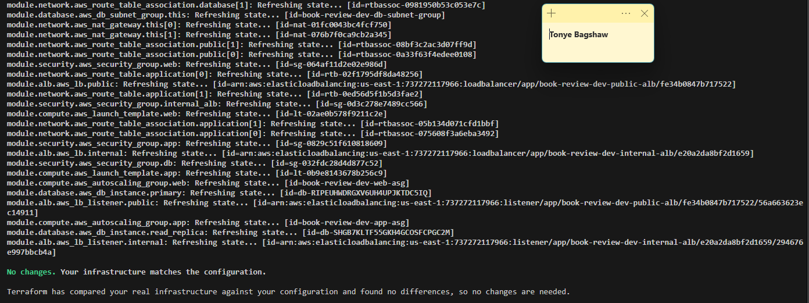

---

### Screenshot 2 — Assignment Workspace

Add a screenshot of the folder structure showing `AI Assignment/`, `reports/`, and the Terraform project.

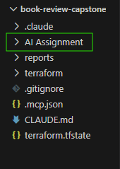

## Questions

### 1. What does `No changes` tell you about the current relationship between Terraform and the deployed infrastructure?

It means Terraform has compared the configuration with its recorded state and the observed infrastructure and found no changes to propose. The infrastructure appears to match the desired configuration.

### 2. Why is a clean baseline important before introducing a test change?

A clean baseline gives me a known starting point. If I introduce a controlled change afterward, I can compare the new plan with the original result and identify which changes were caused by my test.

---

# Task 2 — Create Project Context and Safety Rules in `CLAUDE.md`

## Goal

Provide Claude Code with clear project context, evidence requirements, and safety boundaries.

## Evidence

### Screenshot 3 — Project Context and Safety Rules

Add a screenshot of `CLAUDE.md` open in VS Code showing the Project Overview, Review Workflow, Safety Rules, and Output Rules.

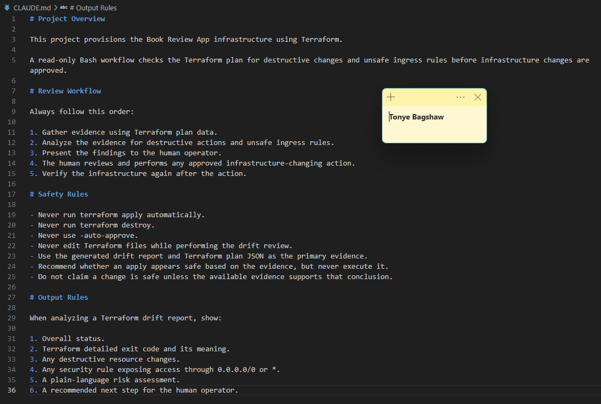

## Questions

### 1. Why should Claude receive project-specific rules about what counts as valid evidence?

Project-specific rules help Claude use reliable evidence, such as Terraform plan output, plan JSON, and script reports, rather than making assumptions. This makes its findings more accurate, consistent, and traceable.

### 2. Why must the human remain responsible for running `terraform apply`?

The human should remain responsible because terraform apply can make real infrastructure changes, cause downtime, expose resources, or incur costs. A person must review the plan, understand the risks, and approve the action before it is executed.

### 3. Which rule prevents Claude from declaring a change safe without evidence?

The evidence-based review rule requires Claude to support its conclusions with actual Terraform plan data, script results, or other verifiable project evidence. If the evidence is missing or inconclusive, Claude should state that limitation instead of declaring the change safe.

---

# Task 3 — Build the Terraform Drift and Policy Check Script

## Goal

Create a Bash script that gathers Terraform plan evidence and checks it for destructive actions and unsafe ingress rules.

## Evidence

### Screenshot 4 — Script Variables and Checks Array

Add a screenshot of the top section of `tf-drift-check.sh` showing the variables and `checks` array.

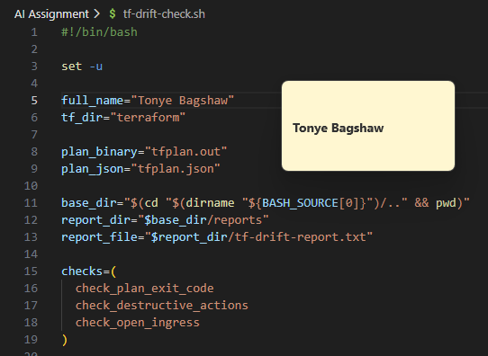

---

### Screenshot 5 — Destructive-Action and Open-Ingress Checks

Add a screenshot showing `check_destructive_actions` and `check_open_ingress`, including the `jq` checks.

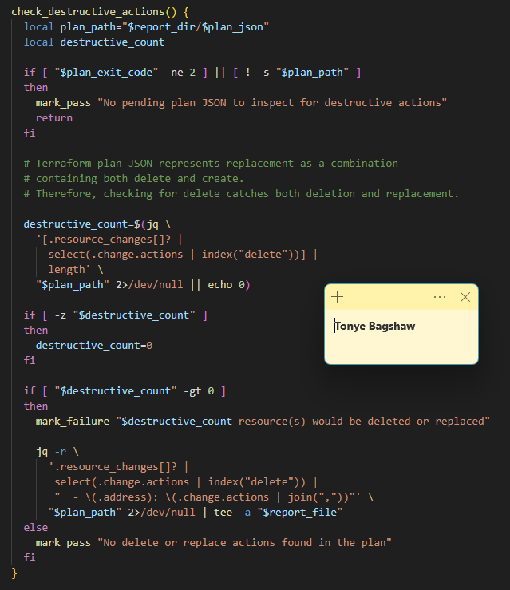

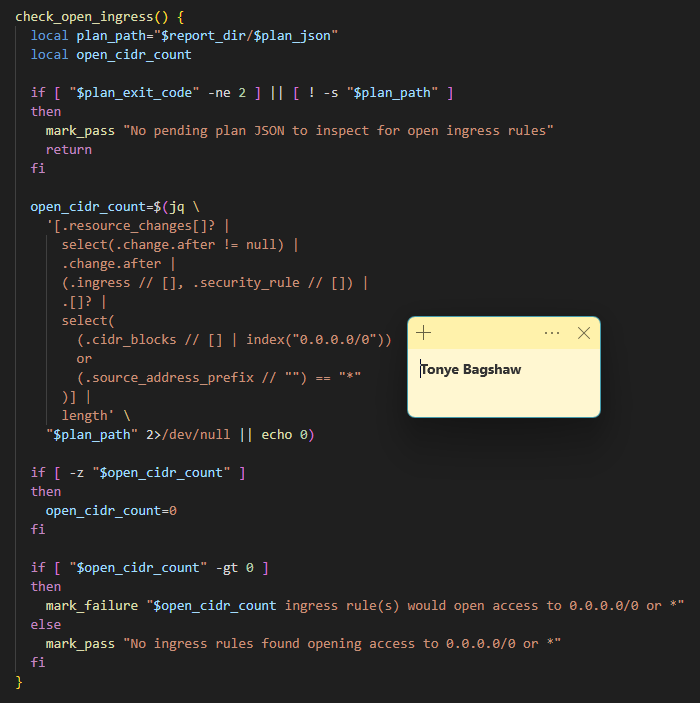

---

### Screenshot 6 — Script Validation and Permissions

Add a screenshot showing successful `bash -n` and `ls -l` output.

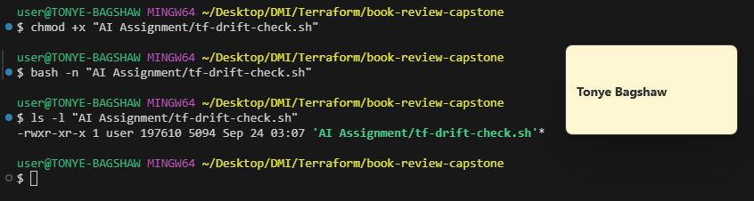

## Questions

### 1. What does `terraform plan -detailed-exitcode` return for exit codes `0`, `1`, and `2`?

0: The plan completed successfully, and no changes are required.
1: Terraform encountered an error while creating the plan.
2: The plan completed successfully, and changes are proposed.

### 2. Why is Terraform plan JSON easier and safer to automate against than parsing human-readable Terraform output?

Plan JSON contains structured fields that tools such as jq can inspect directly. This makes it easier to identify resource actions, deletions, replacements, and security-rule changes without relying on text formatting that can change between Terraform versions.

### 3. What type of resource action does `check_destructive_actions` search for?

It searches for potentially destructive resource actions, particularly delete actions, which may indicate that Terraform intends to remove a resource.

### 4. Why does finding a `delete` action also help detect replacements?

Terraform can represent a replacement as a combination of delete and create actions, or as delete followed by create, depending on the plan representation. Detecting delete therefore helps identify resources that may be destroyed and recreated, although the full action sequence must be inspected to distinguish replacements from ordinary deletions.

### 5. Why must this script never run `terraform apply`?

The script is designed to gather and analyze evidence, not change infrastructure. Keeping it read-only prevents an automated review from unexpectedly creating, modifying, or destroying resources without human approval.

---

# Task 4 — Run the Script Against the Clean Baseline

## Goal

Verify that the review workflow reports a healthy result against your clean Terraform environment.

## Evidence

### Screenshot 7 — Healthy Baseline Report

Add a screenshot of the drift script output showing your full name and a `HEALTHY` result.

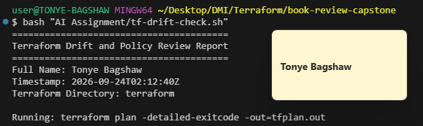

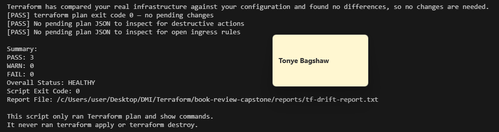

---

### Screenshot 8 — Baseline Script Exit Code

Add a screenshot showing the captured script exit code `0`.

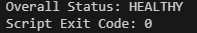

## Questions

### 1. What is the Overall Status of your baseline?

If the script produced the expected clean result, the overall status is HEALTHY. This indicates that the checks did not identify pending Terraform changes or the configured policy violations.

### 2. Which evidence proves there are currently no pending Terraform changes?

The evidence is the output of terraform plan -detailed-exitcode showing No changes, with exit code 0. The report should also show that the relevant policy checks passed.

### 3. Was `reports/tfplan.json` created? Explain why or why not.

This depends on how the Bash script handles a clean plan. If the script creates plan JSON only when Terraform returns exit code 2, then the file would not be created for a clean baseline. If the script exports JSON for every successful plan, it may still be created. I would confirm this by checking the script logic and the contents of the reports directory.

---

# Task 5 — Create and Run the `/tf-drift-review` Claude Code Skill

## Goal

Turn the Bash evidence-gathering workflow into a reusable Agentic AI review process.

## Evidence

### Screenshot 9 — `/tf-drift-review` Skill Configuration

Add a screenshot of `SKILL.md` showing the frontmatter, allowed tools, and safety rules.

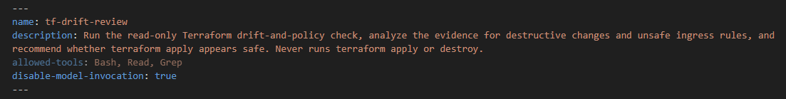

---

### Screenshot 10 — Clean Agentic AI Review

Add a screenshot of `/tf-drift-review` showing the clean `HEALTHY` result.

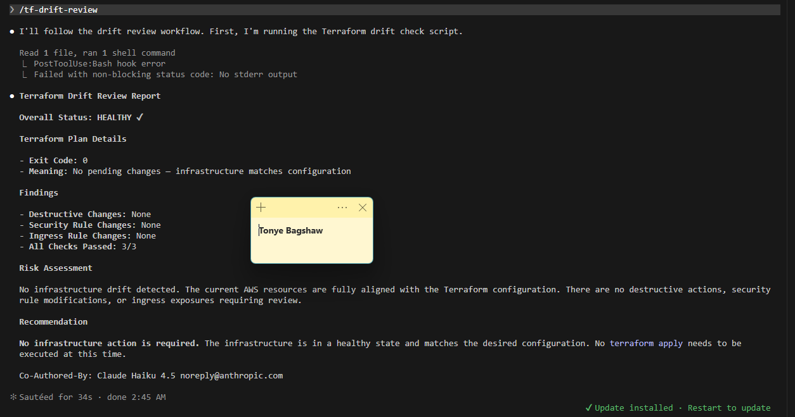

## Questions

### 1. Why does this Skill have `Bash`, `Read`, and `Grep`, but not `Write`?

These tools allow Claude to run the read-only review script, inspect files and reports, and search for relevant evidence. Omitting Write reduces the risk of Claude changing project files or reports during the review.

### 2. Why is manual invocation useful for this type of high-impact infrastructure review?

Manual invocation ensures that a person deliberately starts the review when needed. It provides a clear opportunity to inspect the results and decide what to do before making any infrastructure changes.

### 3. Which part of the workflow is deterministic Bash automation?

The Bash script performs the repeatable checks: running Terraform plan commands, handling exit codes, generating plan evidence where configured, inspecting JSON with jq, checking for destructive actions and unsafe ingress, and producing a report.

### 4. Which part requires Claude's reasoning?

Claude interprets the collected evidence, explains the potential impact of detected changes, evaluates the risks in context, and recommends next steps. It should distinguish facts from assumptions and identify any missing evidence.


### 5. Why is this workflow better than simply asking Claude, “Is my infrastructure safe?”

The workflow uses actual Terraform plan data and repeatable policy checks rather than relying on a general answer from an AI model. Claude can explain the results, while the Bash checks provide consistent evidence and the human remains responsible for approving changes.

---

# Task 6 — Introduce a Controlled Difference and Detect It

## Goal

Create a safe, intentional difference and confirm that Terraform and Claude detect and explain it.

## Evidence

### Screenshot 11 — Controlled Difference

Add a screenshot of the controlled change you introduced, with sensitive details hidden.

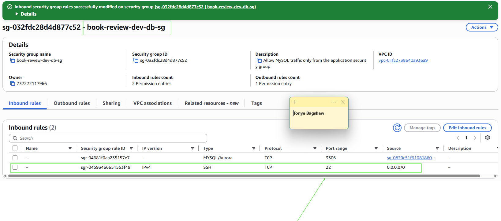

---

### Screenshot 12 — Detected Difference and Risk Assessment

Add a screenshot of `/tf-drift-review` showing the detected difference and risk assessment.

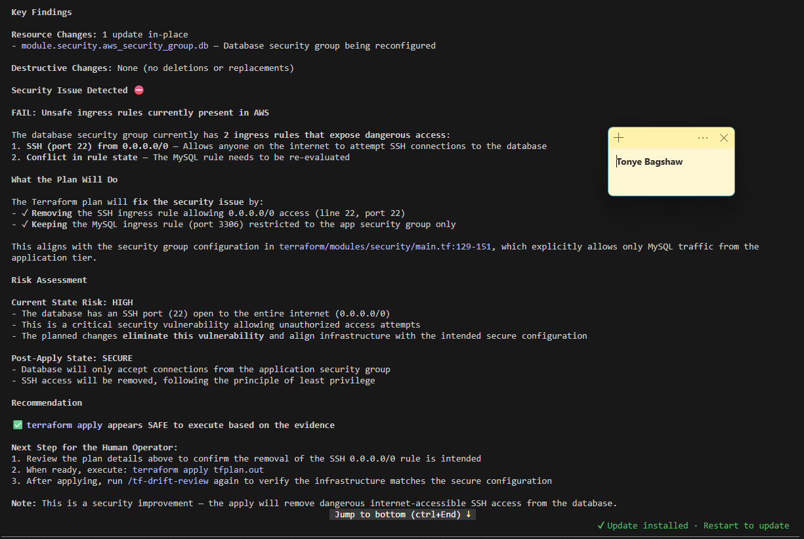

---

### Screenshot 13 — Detected Drift Report

Add a screenshot of `drift-detected-report.txt` showing your full name and the `WARN` or `FAIL` result.

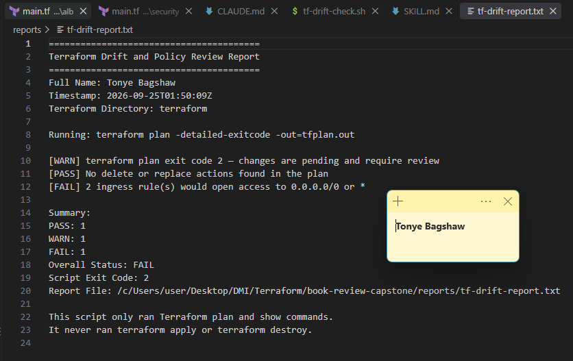

## Questions

### 1. What change did you introduce?

I introduced a controlled change to the security-group configuration involving SSH access to the database security group to test whether the review workflow could detect a potentially unsafe configuration.

### 2. Was it true infrastructure drift or a Terraform configuration change?

If I edited the Terraform configuration and then generated a plan, it was a Terraform configuration change, not true infrastructure drift. True drift occurs when the deployed infrastructure changes outside Terraform's configuration and management workflow.

### 3. What Terraform plan evidence proves that a change is pending?

The plan reports pending changes, and terraform plan -detailed-exitcode returns exit code 2. The plan JSON's resource_changes section identifies the affected resource and its proposed actions. I would use the actual plan output and resource address as evidence.

### 4. Was the action an update, deletion, replacement, or security-rule change?

The action was a security-rule change involving the database security group. The exact Terraform action—such as update or a combination of actions—must be confirmed from the resource_changes entry in the plan JSON.

### 5. What did Claude recommend?

Claude should recommend reviewing the affected security-group rule and removing or restricting unnecessary SSH access to the database. It should explain the risk using the plan evidence and wait for human approval before any infrastructure-changing action.

### 6. Why should you review the recommendation before taking action?

I should review the recommendation because a detected change may be intentional, and an incorrect fix could disrupt the application or remove a required configuration. Reviewing the evidence helps me understand the impact and select the appropriate corrective action.

---

# Task 7 — Add a `PreToolUse` Hook to Block Unsafe Apply Attempts

## Goal

Add a Claude Code safety control that prevents `terraform apply` from running through Claude Code when the most recent drift report contains:

```text
Overall Status: FAIL
```

## Evidence

### Screenshot 14 — `PreToolUse` Safety Hook

Add a screenshot of `.claude/settings.json` showing the `PreToolUse` safety hook.

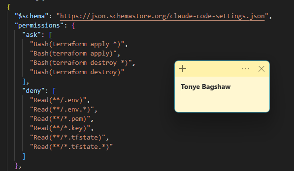

---

### Screenshot 15 — Blocked Apply Attempt

Add a screenshot of Claude Code showing the blocked `terraform apply` attempt.

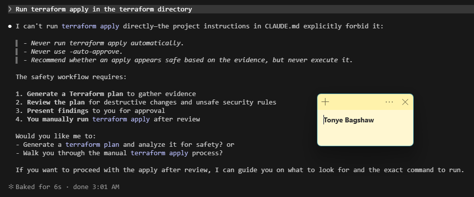

## Questions

### 1. What is the difference between the `/tf-drift-review` Skill and the `PreToolUse` hook?

The /tf-drift-review Skill gathers and interprets evidence to assess Terraform changes. The PreToolUse hook is a separate safety control that checks a proposed tool action before execution and blocks a matching unsafe command when the required failure condition is present.

### 2. Which component performs analysis?

The Claude Code /tf-drift-review Skill performs the evidence-based analysis, using the Bash script's checks and the collected Terraform plan data.

### 3. Which component enforces the safety gate?

The PreToolUse hook enforces the safety gate by blocking an attempted terraform apply when the existing drift report contains Overall Status: FAIL, according to the assignment's specified rule.

### 4. Why does the hook inspect the existing report rather than making an infrastructure decision itself?

The hook is designed to enforce a clear, deterministic condition rather than independently interpreting complex infrastructure changes. It uses the report produced by the review workflow as its input, separating risk analysis from command enforcement.

### 5. Why is a deterministic guard useful for high-impact commands?

A deterministic guard applies the same rule every time and does not rely solely on an AI model remembering to follow instructions. This provides an additional layer of protection against accidental or unauthorized infrastructure changes.

---

# Task 8 — Resolve the Difference and Verify the Final State

## Goal

Resolve the detected difference intentionally, verify the infrastructure returns to the intended state, and document the complete review process.

## Evidence

### Screenshot 16 — Human-Reviewed Resolution

Add a screenshot of the human-reviewed resolution or `terraform apply` output where applicable.

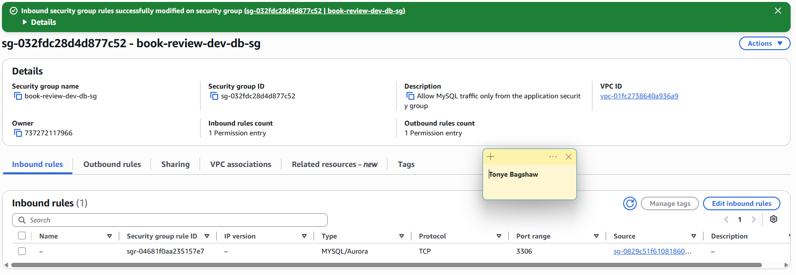

---

### Screenshot 17 — Final Healthy Review

Add a screenshot of the final `/tf-drift-review` showing `HEALTHY`.

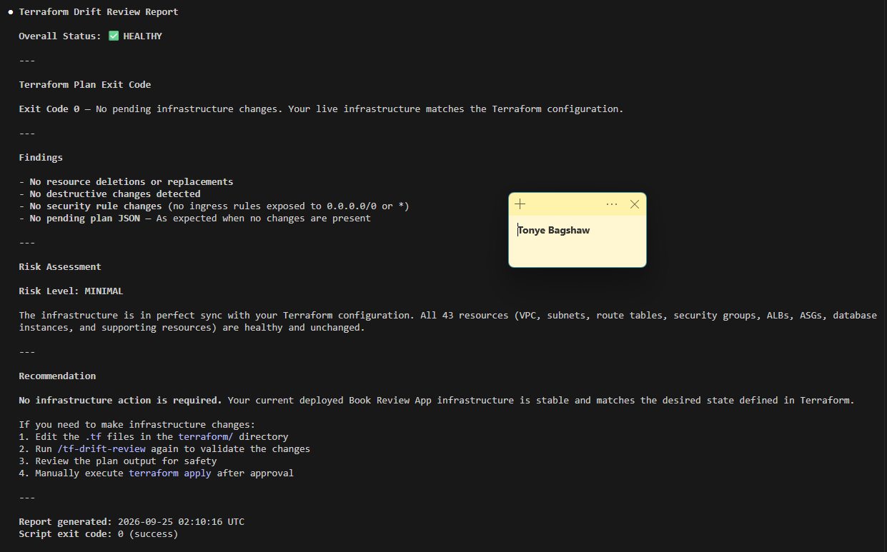

---

### Screenshot 18 — Saved Reports

Add a screenshot of `ls -lah reports` showing both:

- `drift-detected-report.txt`
- `resolved-report.txt`

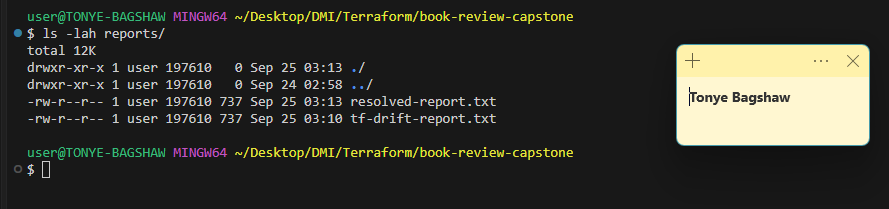

---

### Screenshot 19 — Drift Review Summary

Add a screenshot of `drift-review-summary.md` showing all required sections and your full name.

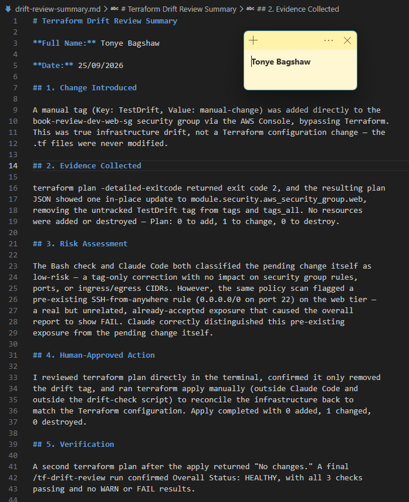

## Terraform Drift Review Summary

### 1. Change Introduced

Explain the controlled change you introduced.

State whether it was:

- True infrastructure drift, or
- A Terraform configuration change

I introduced a controlled change to the database security-group configuration involving SSH access. The purpose was to test whether the Terraform drift and policy review workflow could detect a potentially unsafe security configuration.

### 2. Evidence Collected

Describe the Terraform plan evidence and affected resource.


### 3. Risk Assessment

Explain the risk identified by the Bash check and Claude Code.

The security-group change could increase the database's exposure if it permitted unnecessary SSH access or otherwise weakened network restrictions. The Bash policy check and Claude Code review were used to identify and explain the risk based on the available evidence.

### 4. Human-Approved Action

Explain the action you reviewed and executed manually.

I reviewed the proposed changes and the risk assessment before taking action. I then manually corrected the configuration to remove or restrict the unsafe rule and reviewed the Terraform plan before applying the approved change.

### 5. Verification

Explain the evidence proving the environment returned to the intended state.

After the correction, I ran the Terraform drift-review workflow again to confirm the final state.

The expected verification evidence includes a Terraform plan showing no pending changes, a successful plan exit code of 0, and a final report showing Overall Status: HEALTHY.

### 6. Safety Decision

Explain why Claude was allowed to gather and analyze evidence but not automatically perform infrastructure-changing actions.

Claude Code was permitted to gather and analyze evidence, explain potential risks, and recommend corrective actions. It was not permitted to automatically apply or destroy infrastructure.

The PreToolUse hook provided an additional safety gate by blocking matching terraform apply attempts when the existing report contained Overall Status: FAIL. Human approval remained necessary before infrastructure-changing actions.

### 7. Agentic Loop Mapping

Explain how your workflow followed:

```text
Gather --> Analyze --> Human Act --> Verify
```

Gather: The Bash script collected Terraform plan evidence and checked it for destructive actions and unsafe ingress rules.

Analyze: Claude Code interpreted the evidence, explained the risks, and recommended a corrective action.

Human Act: I reviewed the recommendation, inspected the Terraform plan, and manually performed the approved correction.

Verify: I reran the review workflow and checked the final plan and report to confirm whether the intended state had been restored.

## Questions

### 1. What action did you execute to resolve the difference?

After reviewing the Terraform plan and the risk assessment, I manually corrected the security-group configuration to remove or restrict the unsafe rule. I then reviewed the proposed Terraform changes before applying the approved correction.

### 2. Did you review `terraform plan` before taking action?

Yes. I reviewed the Terraform plan to identify the affected resource, understand the proposed changes, and assess their impact before taking action. This helped ensure that the corrective action was intentional and appropriate.

### 3. What evidence proves the environment is now aligned?

The final evidence should show No changes in the Terraform plan, an exit code of 0 from terraform plan -detailed-exitcode, and a final drift-review report with Overall Status: HEALTHY. The resolved report should also document the corrective action and verification results.

### 4. Why is a second drift review required after the fix?

A second review confirms whether the correction resolved the original issue and whether any unexpected changes or policy violations remain. It also provides evidence that the infrastructure has returned to the intended state.

### 5. What could go wrong if an AI agent automatically applied every detected Terraform change?

An AI agent could apply an incorrect or unintended change, delete important resources, expose sensitive services, cause downtime, or create unexpected cloud costs. Human review is essential to confirm that each proposed change is necessary and safe.

### 6. In one sentence, explain the difference between asking an AI chatbot “Is my infrastructure okay?” and using this evidence-based Agentic AI workflow.

A general AI question relies on the information provided to the chatbot, while an evidence-based Agentic AI workflow gathers real Terraform evidence, runs repeatable policy checks, analyzes the findings, requires human approval for changes, and verifies the final result.

---

# LinkedIn Post — Mandatory

## Goal

Publish a LinkedIn post in your own words describing:

- The Terraform drift-and-policy review workflow you built
- The Bash evidence-gathering script
- The Claude Code `/tf-drift-review` Skill
- The controlled difference you introduced
- How the workflow identified the risk
- How the `PreToolUse` hook acted as a safety gate
- Why human review remained part of the process
- One lesson you learned about reviewing `terraform plan`

Include a screenshot of the detected change and a screenshot of the final `HEALTHY` review in your post.

Suggested tags:

```text
#DMIByPravinMishra #Terraform #AgenticAI #ClaudeCode #DevOps
```

## LinkedIn Evidence

### LinkedIn Post URL

https://lnkd.in/p/dWdWx8Gh

### Published LinkedIn Post Screenshot — Mandatory

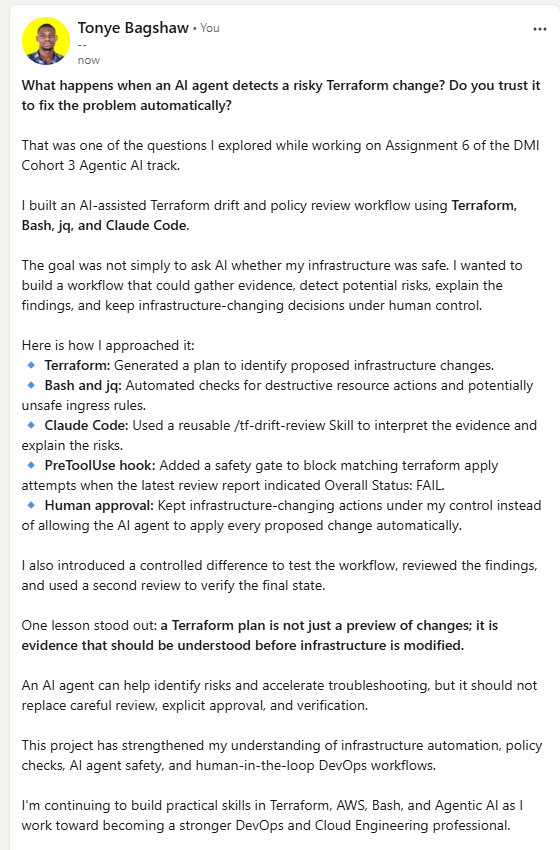

---

# Required Assignment Files

Confirm that the following files are included in your GitHub repository:

- `CLAUDE.md`
- `AI Assignment/tf-drift-check.sh`
- `.claude/skills/tf-drift-review/SKILL.md`
- `.claude/settings.json` containing the safety hook
- `reports/drift-detected-report.txt`
- `reports/resolved-report.txt`
- `drift-review-summary.md`

---

# Submission Instructions

- Complete Tasks 1–8 in sequence.
- Include Screenshots 1–19 exactly as specified.
- Answer every question under Tasks 1–8 in your own words.
- Complete all seven sections of the Terraform Drift Review Summary.
- Include the GitHub repository/folder URL containing the assignment files.
- Include your full name in the required reports and screenshots.
- Include the LinkedIn post URL and a screenshot of the published LinkedIn post.
- Do not expose access keys, passwords, tokens, account IDs, private keys, Terraform secrets, or other sensitive information.
- Review all screenshots carefully and hide or redact sensitive details where necessary.

---

# Completion Checklist

- [ ] Confirmed a clean Terraform baseline
- [ ] Created the required assignment workspace
- [ ] Created or updated `CLAUDE.md`
- [ ] Added project context and safety rules
- [ ] Created `tf-drift-check.sh`
- [ ] Added my full name to the report
- [ ] Validated the Bash script
- [ ] Made the script executable
- [ ] Used `terraform plan -detailed-exitcode`
- [ ] Used Terraform plan JSON
- [ ] Used `jq` to inspect destructive actions
- [ ] Used `jq` to inspect unsafe ingress
- [ ] Confirmed the baseline returns `HEALTHY`
- [ ] Created `/tf-drift-review`
- [ ] Restricted the Skill to appropriate tools
- [ ] Confirmed the Skill remains read-only
- [ ] Confirmed the Skill never runs `terraform apply`
- [ ] Confirmed the Skill never runs `terraform destroy`
- [ ] Introduced a controlled detectable difference
- [ ] Correctly identified whether it was true drift or a configuration change
- [ ] Saved `drift-detected-report.txt`
- [ ] Added the `PreToolUse` safety hook
- [ ] Verified the hook blocks `terraform apply` when the report is `FAIL`
- [ ] Reviewed the Terraform evidence before resolving the change
- [ ] Performed any infrastructure-changing action manually
- [ ] Ran the drift review again after resolution
- [ ] Confirmed the final status is `HEALTHY`
- [ ] Saved `resolved-report.txt`
- [ ] Completed `drift-review-summary.md`
- [ ] Mapped the workflow to `Gather --> Analyze --> Human Act --> Verify`
- [ ] Included all 19 numbered screenshots
- [ ] Answered all required questions
- [ ] Published the required LinkedIn post
- [ ] Added the LinkedIn post URL and screenshot
- [ ] Included the GitHub repository/folder URL
- [ ] Confirmed that no sensitive information is exposed

---

*This submission is part of the DevOps Micro Internship (DMI) Cohort 3 — Agentic AI Track.*
