# Assignment 03 — Deploy a Static Website to Multiple Servers Using a Multi-Play Ansible Playbook

Part of the DevOps Micro Internship (DMI) with Agentic AI

---

## Student Details

**Full Name:** Tonye Bagshaw  
**Cloud Platform Used:** AWS  
**Server 1 URL:** `http://http://16.170.162.145`  
**Server 2 URL:** `http://13.60.210.209`

---

## Purpose

In this assignment, you will create a multi-play Ansible playbook to install Nginx, deploy a static website to two Ubuntu servers, and verify that the website is accessible from both servers.

You may use either AWS EC2 instances or Azure Virtual Machines as your managed servers.

---

# Task 1 — Create the Project Structure

## Goal

Create the required folders and files for the Ansible project.

## Evidence

### Screenshot 1 — Terminal or VS Code showing the complete `static-web` project structure

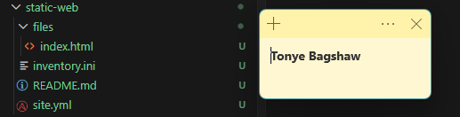

---

# Task 2 — Configure the Ansible Inventory

## Goal

Add both Ubuntu servers to the Ansible inventory.

## Evidence

### Screenshot 2 — Output of `ansible-inventory -i inventory.ini --graph` showing `web1` and `web2`

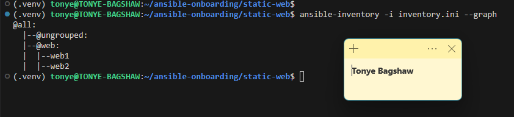

---

## Configuration File

Copy and paste the complete contents of your `inventory.ini` file below:

```ini
[web]
web1 ansible_host=16.170.162.145
web2 ansible_host=13.60.210.209

[web:vars]
ansible_user=ubuntu
ansible_ssh_private_key_file=~/.ssh/id_ed25519
```

---

# Task 3 — Verify Ansible Connectivity

## Goal

Confirm that the Ansible controller can connect to both servers.

## Evidence

### Screenshot 3 — Ansible ping output showing `SUCCESS` and `pong` for both servers

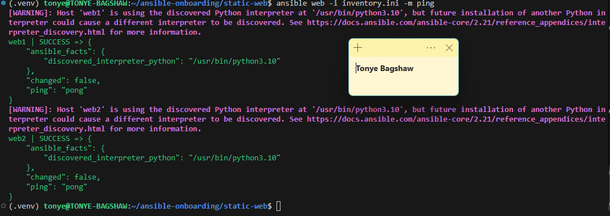

---

# Task 4 — Download and Personalize the Static Website

## Goal

Download `index.html` to the Ansible controller and personalize the website with your full name.

## Evidence

### Screenshot 4 — Edited `files/index.html` showing the footer line with your full name

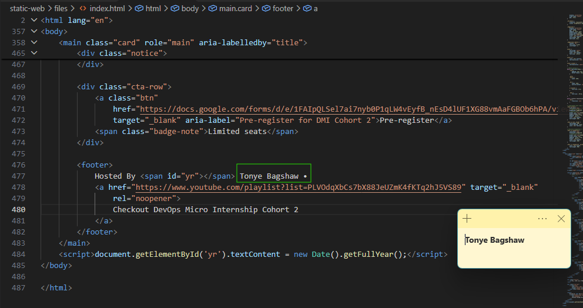

---

# Task 5 — Create the Multi-Play Ansible Playbook

## Goal

Create a single Ansible playbook containing separate plays for installation, deployment, and verification.

## Configuration File

Copy and paste the complete contents of your `site.yml` file below:

```yaml
---
- name: Play 1 - Install and configure Nginx
  hosts: web
  become: true
  gather_facts: true
  handlers:
    - name: Reload nginx
      ansible.builtin.service:
        name: nginx
        state: reloaded

  tasks:
    - name: Install Nginx
      ansible.builtin.apt:
        name: nginx
        state: present
        update_cache: true

    - name: Configure default site
      ansible.builtin.copy:
        dest: /etc/nginx/sites-available/default
        content: |
          server {
              listen 80 default_server;
              listen [::]:80 default_server;
              root /var/www/html;
              index index.html;
              server_name _;

              location / {
                  try_files $uri $uri/ =404;
              }
          }
        backup: true
      notify: Reload nginx

    - name: Ensure Nginx service is enabled and running
      ansible.builtin.service:
        name: nginx
        state: started
        enabled: true

- name: Play 2 - Deploy the static website
  hosts: web
  become: true
  gather_facts: false
  handlers:
    - name: Reload nginx after deployment
      ansible.builtin.service:
        name: nginx
        state: reloaded

  tasks:
    - name: Ensure the web root exists
      ansible.builtin.file:
        path: /var/www/html
        state: directory
        owner: www-data
        group: www-data
        mode: '0755'

    - name: Copy the static website files
      ansible.builtin.copy:
        src: files/index.html
        dest: /var/www/html/index.html
        owner: www-data
        group: www-data
        mode: '0644'
      notify: Reload nginx after deployment

- name: Play 3 - Verify both websites from the Ansible controller
  hosts: localhost
  gather_facts: false
  tasks:
    - name: Request both websites and capture responses
      ansible.builtin.uri:
        url: "http://{{ hostvars[item].ansible_host }}/"
        return_content: true
        status_code: 200
      loop: "{{ groups['web'] }}"
      register: website_checks

    - name: Assert both websites are healthy and serving the expected content
      ansible.builtin.assert:
        that:
          - website_checks.results | length == 2
          - item.status == 200
          - "'DevOps Micro Internship' in item.content"
      loop: "{{ website_checks.results }}"

```

---

# Task 6 — Validate the Playbook Syntax

## Goal

Check the playbook for YAML or Ansible syntax errors before running it.

## Evidence

### Screenshot 5 — Successful syntax-check output showing `playbook: site.yml`

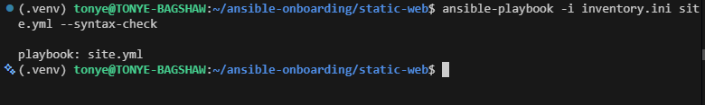

---

# Task 7 — Run the Multi-Play Playbook

## Goal

Install Nginx, deploy the website, and verify both servers in one playbook run.

## Evidence

### Screenshot 6 — Play 3 verification showing HTTP `200` for both servers

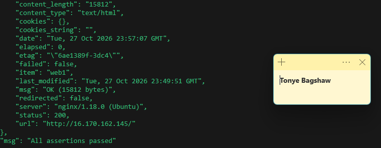

---

### Screenshot 7 — Final play recap showing `unreachable=0` and `failed=0` for `web1`, `web2`, and `localhost`

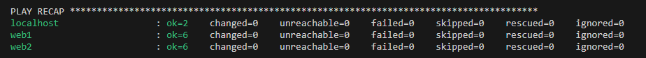

---

# Task 8 — Verify Idempotency

## Goal

Run the playbook again and confirm that it does not make unnecessary changes.

## Evidence

### Screenshot 8 — Second playbook run showing the play recap with `changed=0`, `unreachable=0`, and `failed=0` for both web servers

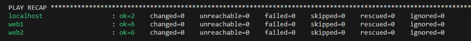

---

# Task 9 — Test Both Websites Manually

## Goal

Confirm that the static website is accessible from both public IP addresses.

## Evidence

### Screenshot 9 — `curl -I` output showing HTTP `200 OK` from both servers

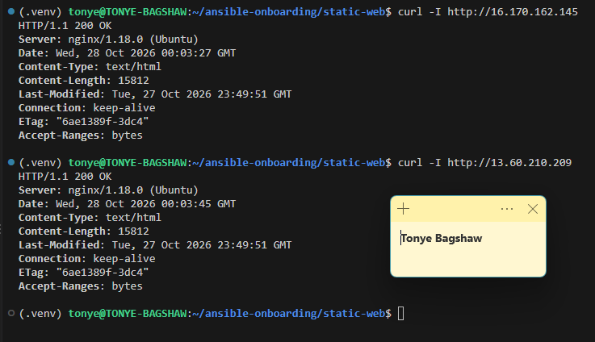

---

### Screenshot 10 — Browser showing the website from Server 1 with the public IP and your full name visible

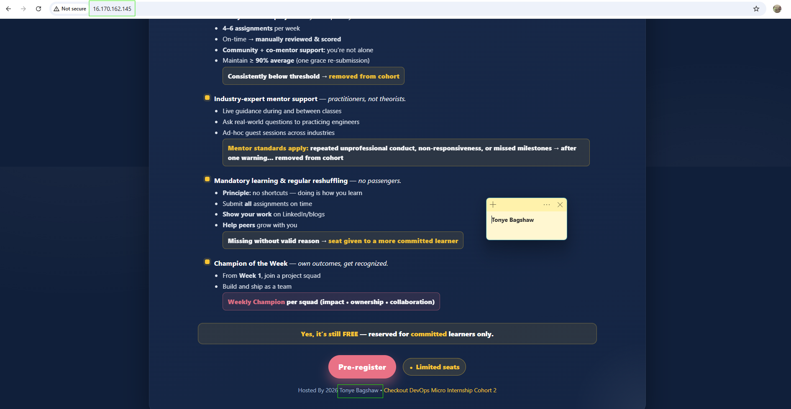

---

### Screenshot 11 — Browser showing the website from Server 2 with the public IP and your full name visible

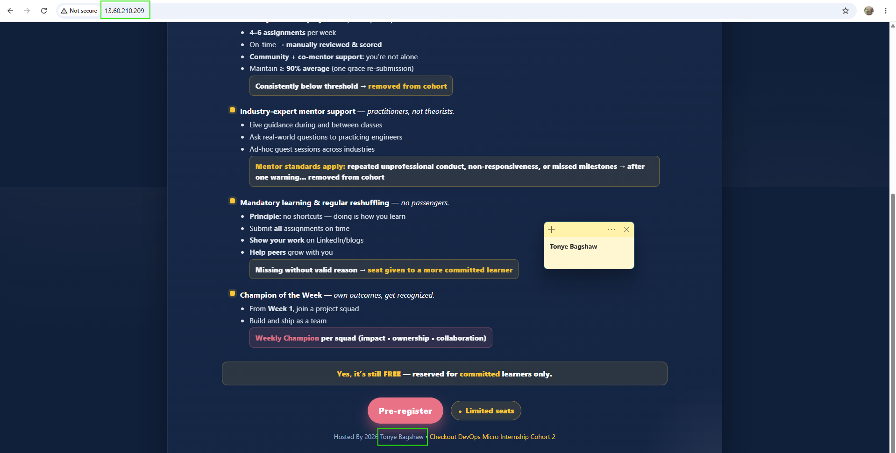

---

## Website URLs

Add both deployed website URLs below:

```text
Server 1: http://16.170.162.145
Server 2: http://13.60.210.209
```

---

# Task 10 — Complete the Project README

## Goal

Document how the project works and record what you learned.

## README Content

Copy and paste the complete contents of your `README.md` file below:

```markdown
# Assignment 03: Deploy a Static Website to Multiple Servers Using Ansible

**Author:** Tonye Bagshaw  
**Program:** DevOps Micro Internship (DMI), Agentic AI Track  
**Cloud Provider:** Amazon Web Services (AWS)  
**Tools:** AWS EC2, Ubuntu, Ansible, Nginx, SSH, Git

## Project Overview

This project demonstrates how to use Ansible to automate the deployment of a static website to multiple Ubuntu servers hosted on AWS EC2.

Instead of configuring each server manually, I created a multi-play Ansible playbook that installs and configures Nginx, deploys website files, and verifies that the website is accessible from both servers.

The project focuses on automation, configuration management, secure SSH access, and repeatable deployments.

## Objectives

- Configure an Ansible inventory containing two Ubuntu web servers.
- Establish SSH key-based authentication from the Ansible controller.
- Install and configure Nginx using Ansible.
- Deploy a personalized static website to both servers.
- Verify HTTP responses from the Ansible controller.
- Demonstrate playbook syntax validation and idempotency.

## Infrastructure

The project uses two AWS EC2 Ubuntu instances managed from an Ansible controller running Ubuntu under WSL.

| Server | Public IP address | Role |
|---|---|---|
| web1 | `16.170.162.145` | Web server 1 |
| web2 | `13.60.210.209` | Web server 2 |

Both servers belong to the Ansible `web` inventory group.

## Project Structure

```text
static-web/
├── inventory.ini
├── site.yml
├── files/
│   └── index.html
└── README.md
```

- `inventory.ini`: Defines the managed servers and SSH connection settings.
- `site.yml`: Contains the multi-play Ansible automation.
- `files/index.html`: Contains the static website deployed to both servers.
- `README.md`: Documents the project setup, execution, and verification.

## Prerequisites

Before running the project, ensure you have:

- Ansible installed on the controller.
- Two running Ubuntu EC2 instances.
- SSH key-based access to both instances.
- The private SSH key available on the controller.
- AWS security group rules allowing SSH from the controller's public IP and HTTP traffic on port 80.
- Network connectivity to both web servers.

Keep the SSH private key secure and never commit it to Git.

## Ansible Inventory

The `inventory.ini` file groups both servers under `[web]`.

```ini
[web]
web1 ansible_host=16.170.162.145
web2 ansible_host=13.60.210.209

[web:vars]
ansible_user=ubuntu
ansible_ssh_private_key_file=/home/tonye/.ssh/id_ed25519
```

The inventory allows Ansible to manage both servers together instead of connecting to each one manually.

To display the inventory structure, run:

```bash
ansible-inventory -i inventory.ini --graph
```

## Playbook Workflow

The `site.yml` playbook contains three separate plays.

### Play 1: Install and Configure Nginx

This play targets the `web` group and:

- Updates the package cache.
- Installs Nginx.
- Configures the default Nginx site.
- Ensures Nginx is running and enabled at boot.
- Reloads Nginx when its configuration changes.

### Play 2: Deploy the Static Website

This play:

- Ensures `/var/www/html` exists.
- Copies `files/index.html` to the web root on both servers.
- Sets the appropriate file ownership and permissions.
- Notifies a handler to reload Nginx after deployment changes.

### Play 3: Verify Both Websites

This play runs on the Ansible controller and uses the Ansible `uri` module to request both websites.

It checks that:

- Both HTTP requests return status code `200`.
- The expected website content is present.
- Both servers are responding correctly.

An assertion task reports a failure if either website does not meet the expected conditions.

## Running the Project

Run the following commands from the `static-web` project directory.

### 1. Verify SSH Access

Test connectivity to both servers:

```bash
ansible all -i inventory.ini -m ping
```

Successful connections should return `SUCCESS` and `pong` for both `web1` and `web2`.

### 2. Validate Playbook Syntax

```bash
ansible-playbook -i inventory.ini site.yml --syntax-check
```

This checks the playbook for syntax errors before execution.

### 3. Execute the Playbook

```bash
ansible-playbook -i inventory.ini site.yml
```

This installs Nginx, deploys the website, and verifies both servers in one run.

### 4. Verify Idempotency

Run the playbook again:

```bash
ansible-playbook -i inventory.ini site.yml
```

An idempotent run should report `changed=0` for both web servers when the configuration and deployed content are already correct.

### 5. Test HTTP Responses

```bash
curl -I http://16.170.162.145
curl -I http://13.60.210.209
```

Both servers should return an HTTP `200 OK` response.

## Deployed Website URLs

- **Server 1:** http://16.170.162.145
- **Server 2:** http://13.60.210.209

These addresses are the configured public IPs for this project. Update them if the EC2 instances receive new public IP addresses.

## Security Considerations

- Use SSH key-based authentication rather than exposing passwords.
- Restrict SSH access to the trusted controller IP.
- Allow inbound HTTP traffic on port 80 only where required.
- Do not commit private SSH keys, AWS credentials, or other secrets.
- Keep security group rules and server access permissions appropriately restricted.

## Challenges and Lessons Learned

One challenge was SSH host key verification when connecting to the EC2 instances from the Ansible controller. The issue required checking SSH connectivity and ensuring that the servers' host keys were trusted.

This project helped me understand how Ansible inventories, SSH authentication, multi-play playbooks, handlers, and modules work together to automate server configuration and application deployment.

I also learned the importance of idempotency, which allows the same playbook to be executed repeatedly without making unnecessary changes when the desired state has already been achieved.

## Conclusion

This project demonstrates a practical approach to deploying and verifying a static website across multiple AWS EC2 instances using Ansible.

By separating installation, deployment, and verification into individual plays, the workflow is easier to understand, troubleshoot, and maintain. It also provides a foundation for more advanced configuration management and infrastructure automation projects.

## Learning Resources

- [Ansible Documentation](https://docs.ansible.com/)
- [Ansible Playbooks](https://docs.ansible.com/ansible/latest/playbook_guide/playbooks_intro.html)
- [AWS EC2 Documentation](https://docs.aws.amazon.com/ec2/)
- [NGINX Documentation](https://nginx.org/en/docs/)

---

*Part of the DevOps Micro Internship (DMI), Agentic AI Track.*


---

# LinkedIn Post Required

## Evidence

### LinkedIn Post URL

Paste your LinkedIn post URL here:

`https://lnkd.in/p/dQZVPEnp`

---

### Screenshot — Published LinkedIn post

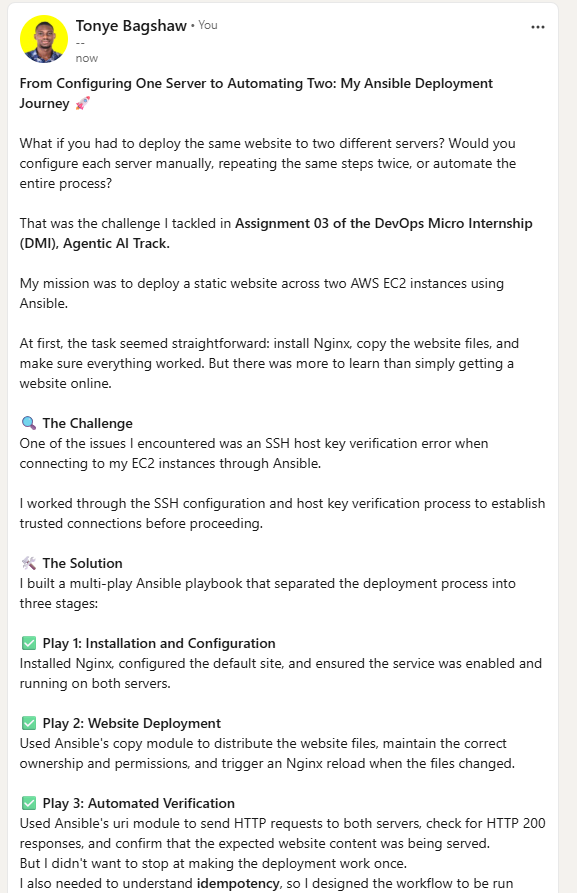

---

# Assignment Questions

Answer the following in your own words:

**1. What issue did you face while completing this assignment, and how did you fix it?**

I encountered an SSH host key verification error when trying to connect to my EC2 instances using Ansible. I fixed the issue by checking the server's identity and verifying its SSH host key before establishing a trusted connection. I also checked my inventory configuration and SSH private key path to ensure Ansible could connect to the servers correctly.

---

**2. What did you learn from this assignment?**

I learned how to use Ansible to automate the deployment of a static website across multiple AWS EC2 instances. I gained practical experience writing a multi-play playbook, installing and managing Nginx, copying website files, using handlers, and verifying deployments automatically. I also learned the importance of idempotency and testing the application after deployment.

---

**3. Why is it useful to split installation, deployment, and verification into separate plays?**

Splitting these tasks into separate plays makes the playbook easier to understand, maintain, and troubleshoot. Each play has a specific responsibility: installation prepares the servers, deployment copies the website files, and verification checks whether the website is working correctly. This separation also makes it easier to identify which stage failed.

---

**4. What is one benefit of using the Ansible `copy` module instead of cloning the website directly from Git on every managed server?**

One benefit is that the copy module allows me to keep the website files on the Ansible control node and distribute them directly to all managed servers. This avoids the need to install or configure Git on each server and ensures that every server receives the same version of the website files.

---

**5. What does idempotency mean in this assignment?**

Idempotency means that running the same Ansible playbook multiple times produces the same desired state without making unnecessary changes. For example, once Nginx is installed and the website file is correctly deployed, running the playbook again should not reinstall or modify resources that are already configured correctly.

---

**6. What does the Ansible `uri` module verify in Play 3?**

The uri module sends HTTP requests to both web servers and checks that each server returns an HTTP 200 status code. It also retrieves the response content so the playbook can verify that the website contains the expected text, “DevOps Micro Internship.” This confirms that the website is accessible and serving the correct content.

---

# Required Files

Confirm that the following files are included in your assignment folder:

- [ ] `inventory.ini`
- [ ] `site.yml`
- [ ] `files/index.html`
- [ ] `README.md`

---

# Submission Instructions

- Add all required screenshots in the correct order.
- Full Name must be visible in required screenshots.
- Include both deployed website URLs.
- Paste `inventory.ini`, `site.yml`, and `README.md` as editable text.
- Answer all assignment questions clearly in your own words.
- Add your LinkedIn post URL.
- Do not expose SSH private keys, passwords, cloud account IDs, or other sensitive information.

---

# Completion Checklist

- [ ] Task 1: `static-web` folder structure is complete
- [ ] Task 2: Both servers are listed under the `[web]` group in `inventory.ini`
- [ ] Task 2: Inventory graph shows `web1` and `web2`
- [ ] Task 3: Ansible ping returns `SUCCESS` and `pong` for both servers
- [ ] Task 4: `files/index.html` contains your full name
- [ ] Task 5: `site.yml` contains three separate plays
- [ ] Task 5: Play 1 installs, starts, and enables Nginx
- [ ] Task 5: Play 2 deploys `index.html` using the `copy` module
- [ ] Task 5: Nginx reload handler is included
- [ ] Task 5: Play 3 verifies both web servers from the controller
- [ ] Task 6: Playbook syntax check passes
- [ ] Task 7: First playbook run completes with `unreachable=0` and `failed=0`
- [ ] Task 7: URI verification returns HTTP `200` for both servers
- [ ] Task 8: Second playbook run demonstrates idempotency
- [ ] Task 8: Second run shows `changed=0` for both web servers
- [ ] Task 9: Both `curl -I` commands return HTTP `200 OK`
- [ ] Task 9: Website loads from Server 1
- [ ] Task 9: Website loads from Server 2
- [ ] Task 9: Full name is visible on both deployed websites
- [ ] Task 10: `README.md` contains all required explanations
- [ ] Screenshots 1–11 are included
- [ ] `inventory.ini`, `site.yml`, and `README.md` are pasted as editable text
- [ ] Both website URLs are included
- [ ] Assignment questions are answered
- [ ] LinkedIn post published
- [ ] LinkedIn post URL added
- [ ] No sensitive information is exposed

---

## About DMI & CloudAdvisory

DevOps Micro Internship (DMI) is a project-based DevOps program run by Pravin Mishra and The CloudAdvisory, focused on real-world execution, systems thinking, and career readiness.

It helps learners build strong DevOps foundations with hands-on experience.

---

## Resources

- DMI Official Website: [https://dmi.pravinmishra.com?utm_source=github&utm_medium=readme](https://dmi.pravinmishra.com?utm_source=github&utm_medium=readme)
- University: [https://university.pravinmishra.com?utm_source=github&utm_medium=readme](https://university.pravinmishra.com?utm_source=github&utm_medium=readme)
- Discord Community: [https://discord.pravinmishra.com?utm_source=github&utm_medium=readme](https://discord.pravinmishra.com?utm_source=github&utm_medium=readme)
- Blog: [https://dmi.pravinmishra.com/blog?utm_source=github&utm_medium=readme](https://dmi.pravinmishra.com/blog?utm_source=github&utm_medium=readme)
- YouTube Playlist: [https://www.youtube.com/playlist?list=PLFeSNDtI4Cho](https://www.youtube.com/playlist?list=PLFeSNDtI4Cho)
- Pravin Mishra LinkedIn: [https://www.linkedin.com/in/pravin-mishra-aws-trainer/](https://www.linkedin.com/in/pravin-mishra-aws-trainer/)
- CloudAdvisory LinkedIn: [https://www.linkedin.com/company/thecloudadvisory/](https://www.linkedin.com/company/thecloudadvisory/)

---

*This submission is part of DevOps Micro Internship (DMI) — Agentic AI Track.*