# Assignment 04 — Deploy Mini Finance on Azure Using Terraform and Ansible

Part of the DevOps Micro Internship (DMI) with Agentic AI

---

## Purpose

In this assignment, you will provision Azure infrastructure using Terraform and deploy the Mini Finance website using an Ansible multi-play playbook.

Terraform will create the Azure Virtual Machine and networking resources. Ansible will install Nginx, clone the Mini Finance repository, deploy the website, and verify the deployment.

---

# Task 1 — Create the Project Structure

## Goal

Create separate directories and files for the Terraform infrastructure and Ansible configuration.

### Evidence

#### Screenshot 1 — Terminal or VS Code showing the complete `mini-finance` project structure

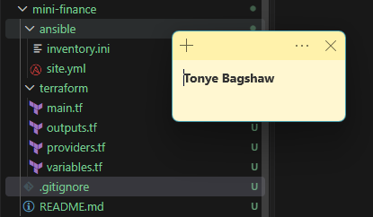

---

### Notes

I created a structured mini-finance project with separate directories for Terraform and Ansible. This organization keeps the AWS infrastructure configuration separate from the server configuration and application deployment files, making the project easier to maintain, troubleshoot, and manage.

---

# Task 2 — Create the Azure Infrastructure Using Terraform

## Goal

Use Terraform to provision an Ubuntu Virtual Machine with the required Azure networking and security resources.

### Evidence

#### Screenshot 2 — Terraform code showing the `Allow-SSH` rule for port `22` and the `Allow-HTTP` rule for port `80`

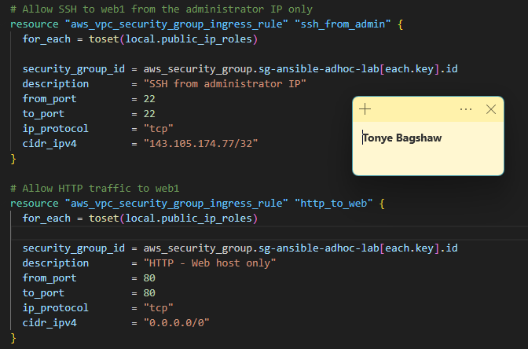

---

#### Screenshot 3 — Terraform code showing the association between `nsg-mini-finance` and `nic-mini-finance`


---

### Notes

I used Terraform to provision the AWS infrastructure for the Mini Finance project, including a VPC, subnet, security group, network interface, and Ubuntu EC2 instance. I configured security group rules to allow SSH access on port 22 and HTTP traffic on port 80, and associated the security group with the network interface to enable secure remote access and website connectivity.

---

# Task 3 — Initialize and Apply the Terraform Configuration

## Goal

Format and validate the Terraform configuration, review the execution plan, and provision the Azure infrastructure.

### Evidence

#### Screenshot 4 — End of the `terraform apply` output showing `Apply complete!` with no errors

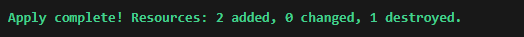

---

#### Screenshot 5 — Output of `terraform output public_ip` showing the VM’s public IP address

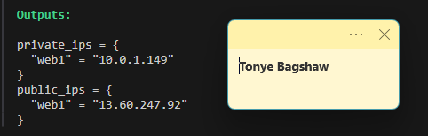

---

### Notes

I formatted and validated the Terraform configuration, reviewed the execution plan, and applied it to provision the Azure infrastructure. The apply operation completed without errors, and I retrieved the VM’s public IP address using terraform output public_ip for the subsequent SSH and Ansible configuration.

---

# Task 4 — Verify Passwordless SSH Access

## Goal

Confirm that the Ansible controller can connect to the Terraform-provisioned Azure VM using SSH key authentication.

### Evidence

#### Screenshot 6 — Passwordless SSH command and the returned `mini-finance` hostname

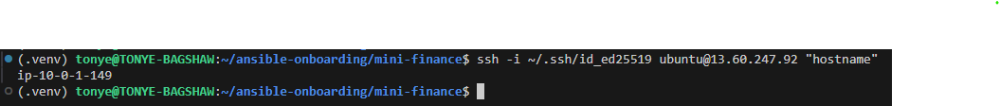

---

### Notes

I verified that the Ansible controller could connect to the VM using SSH key authentication without requiring a password. The returned mini-finance hostname confirmed that the SSH connection was successful and the VM was reachable.

---

# Task 5 — Create the Ansible Inventory and Verify Connectivity

## Goal

Add the Terraform-provisioned Azure VM to the Ansible inventory and confirm that Ansible can connect to it.

### Evidence

#### Screenshot 7 — Ansible ping output showing `SUCCESS` and `pong` from the Azure VM

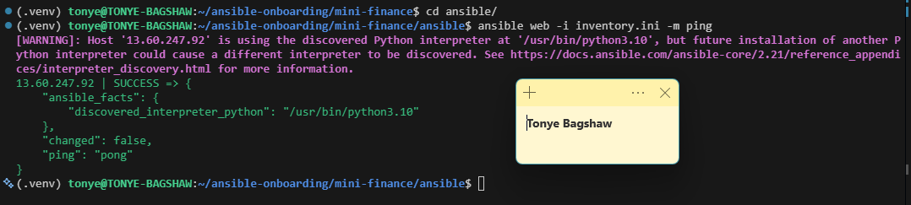

---

### Configuration File

Copy and paste the complete contents of your `ansible/inventory.ini` file below:

```ini
[web]
13.60.247.92

[web:vars]
ansible_user=ubuntu
ansible_ssh_private_key_file=~/.ssh/id_ed25519
```

---

# Task 6 — Create the Multi-Play Ansible Playbook

## Goal

Create one Ansible playbook containing separate plays to install Nginx, deploy the Mini Finance website, and verify the deployment.

### Evidence

#### Screenshot 8 — `site.yml` showing Play 1 and the beginning of Play 2

Screenshot must show:

- Play 1 targeting the `web` group
- Installation of `nginx`, `git`, and `rsync`
- Nginx service configured as started and enabled
- Beginning of Play 2 with the Git repository URL and synchronization task

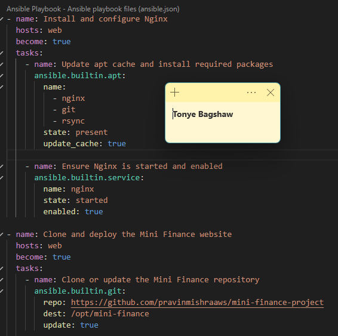

---

#### Screenshot 9 — `site.yml` showing the deployment destination, handler, and Play 3 verification

Screenshot must show:

- Website destination `/var/www/html/`
- Ownership set to `www-data:www-data`
- Nginx reload handler
- Play 3 targeting `localhost`
- The `uri` verification and `assert` condition

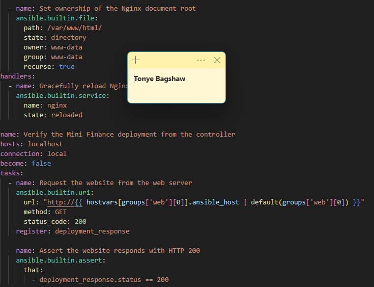

---

### Configuration File

Copy and paste the complete contents of your `ansible/site.yml` file below:

```yaml
---
- name: Install and configure Nginx
  hosts: web
  become: true
  tasks:
    - name: Update apt cache and install required packages
      ansible.builtin.apt:
        name:
          - nginx
          - git
          - rsync
        state: present
        update_cache: true

    - name: Ensure Nginx is started and enabled
      ansible.builtin.service:
        name: nginx
        state: started
        enabled: true

- name: Clone and deploy the Mini Finance website
  hosts: web
  become: true
  tasks:
    - name: Clone or update the Mini Finance repository
      ansible.builtin.git:
        repo: https://github.com/pravinmishraaws/mini-finance-project
        dest: /opt/mini-finance
        update: true

    - name: Synchronize website files to the Nginx document root
      ansible.posix.synchronize:
        src: /opt/mini-finance/
        dest: /var/www/html/
        rsync_opts:
          - "--exclude=.git"
      delegate_to: "{{ inventory_hostname }}"
      notify: Gracefully reload Nginx

    - name: Set ownership of the Nginx document root
      ansible.builtin.file:
        path: /var/www/html/
        state: directory
        owner: www-data
        group: www-data
        recurse: true
  handlers:
    - name: Gracefully reload Nginx
      ansible.builtin.service:
        name: nginx
        state: reloaded

- name: Verify the Mini Finance deployment from the controller
  hosts: localhost
  connection: local
  become: false
  tasks:
    - name: Request the website from the web server
      ansible.builtin.uri:
        url: "http://{{ hostvars[groups['web'][0]].ansible_host | default(groups['web'][0]) }}"
        method: GET
        status_code: 200
      register: deployment_response

    - name: Assert the website responds with HTTP 200
      ansible.builtin.assert:
        that:
          - deployment_response.status == 200
```

---

# Task 7 — Validate and Run the Ansible Playbook

## Goal

Validate the syntax of the multi-play Ansible playbook and run it to install Nginx, deploy the Mini Finance website, and verify the deployment.

### Evidence

#### Screenshot 10 — Successful playbook syntax check showing `playbook: site.yml`

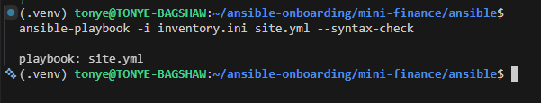

---

#### Screenshot 11 — Play 3 output showing the successful HTTP verification and assertion

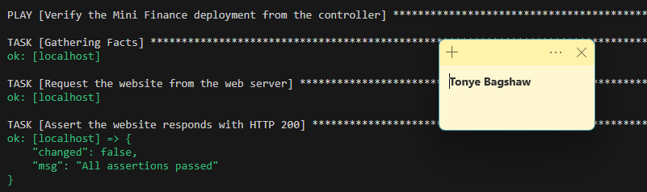

---

#### Screenshot 12 — Final `PLAY RECAP` showing `failed=0` and `unreachable=0`

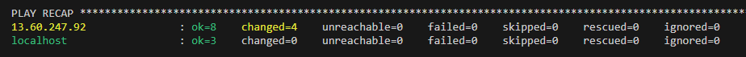

---

### Notes

I validated the Ansible playbook syntax and ran it to install Nginx, deploy the Mini Finance website, and verify the HTTP response. I also troubleshot a Git repository access issue during deployment.

---

# Task 8 — Test the Mini Finance Website in a Browser

## Goal

Confirm that the Mini Finance website is publicly accessible through the Azure VM’s public IP address.

### Evidence

#### Screenshot 13 — Mini Finance website successfully loading in the browser, with the Azure VM’s public IP address visible in the address bar

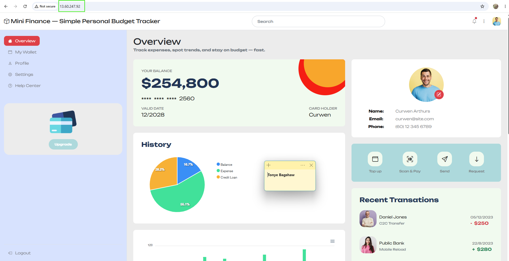

---

### Website URL

Add your deployed website URL below:

```text
http://13.60.247.92
```

---

# Task 9 — Create the Project README

## Goal

Create a `README.md` file to document the Mini Finance infrastructure and deployment project.

### Evidence

#### Screenshot 14 — Completed `README.md` displayed in the VS Code Markdown preview or terminal

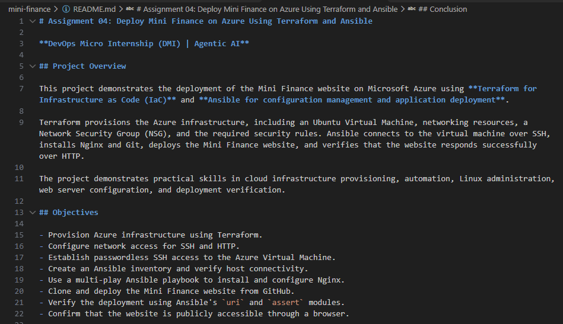

---

### README Content

Copy and paste the complete contents of your `README.md` file below:

```markdown
# Assignment 04: Deploy Mini Finance on Azure Using Terraform and Ansible

**DevOps Micro Internship (DMI) | Agentic AI**

## Project Overview

This project demonstrates the deployment of the Mini Finance website on Microsoft Azure using **Terraform for Infrastructure as Code (IaC)** and **Ansible for configuration management and application deployment**.

Terraform provisions the Azure infrastructure, including an Ubuntu Virtual Machine, networking resources, a Network Security Group (NSG), and the required security rules. Ansible connects to the virtual machine over SSH, installs Nginx and Git, deploys the Mini Finance website, and verifies that the website responds successfully over HTTP.

The project demonstrates practical skills in cloud infrastructure provisioning, automation, Linux administration, web server configuration, and deployment verification.

## Objectives

- Provision Azure infrastructure using Terraform.
- Configure network access for SSH and HTTP.
- Establish passwordless SSH access to the Azure Virtual Machine.
- Create an Ansible inventory and verify host connectivity.
- Use a multi-play Ansible playbook to install and configure Nginx.
- Clone and deploy the Mini Finance website from GitHub.
- Verify the deployment using Ansible's `uri` and `assert` modules.
- Confirm that the website is publicly accessible through a browser.

## Technology Stack

| Technology      | Purpose                                                     |
| --------------- | ----------------------------------------------------------- |
| Microsoft Azure | Cloud infrastructure hosting                                |
| Terraform       | Infrastructure provisioning                                 |
| Ansible         | Configuration management and deployment automation          |
| Ubuntu Linux    | Virtual Machine operating system                            |
| Nginx           | Web server                                                  |
| Git and GitHub  | Application source code management                          |
| SSH             | Secure remote server access                                 |
| YAML            | Configuration for Terraform variables and Ansible playbooks |

## Project Architecture

The deployment follows this workflow:

```text
Ansible Controller
       |
       | Terraform
       v
Microsoft Azure
       |
       +-- Virtual Network
       |
       +-- Network Security Group
       |      |
       |      +-- Allow SSH (Port 22)
       |      +-- Allow HTTP (Port 80)
       |
       +-- Network Interface
       |
       +-- Ubuntu Virtual Machine
                    |
                    | SSH
                    v
                 Ansible
                    |
                    +-- Install Nginx, Git and rsync
                    |
                    +-- Clone Mini Finance repository
                    |
                    +-- Deploy website files
                    |
                    +-- Reload Nginx
                    |
                    +-- Verify HTTP response
                             |
                             v
                      Public Web Browser
```

## Project Structure

The project separates Terraform infrastructure configuration from Ansible deployment configuration.

```text
mini-finance/
├── terraform/
│   ├── main.tf
│   ├── variables.tf
│   ├── outputs.tf
│   ├── terraform.tfvars
│   └── providers.tf
│
└── ansible/
    ├── inventory.ini
    └── site.yml
```

The exact Terraform filenames may differ depending on the configuration. Terraform automatically loads applicable `.tf` files in the same working directory.

### Directory Responsibilities

- `terraform/`: Contains the configuration for provisioning Azure resources.
- `main.tf`: Defines infrastructure resources.
- `variables.tf`: Declares configurable Terraform inputs.
- `outputs.tf`: Exposes useful deployment information, including the public IP.
- `terraform.tfvars`: Supplies variable values.
- `providers.tf`: Configures Terraform and the AzureRM provider.
- `ansible/inventory.ini`: Identifies the target Azure Virtual Machine.
- `ansible/site.yml`: Defines the deployment and verification workflow.

## Task 1: Create the Project Structure

Separate directories were created for Terraform and Ansible to keep infrastructure provisioning independent from application deployment.

This separation improves organization, maintainability, and troubleshooting.

## Task 2: Provision Azure Infrastructure Using Terraform

Terraform defines and provisions the infrastructure required to host the Mini Finance website.

The infrastructure includes:

- An Azure Resource Group.
- A Virtual Network and subnet.
- A Network Security Group named `nsg-mini-finance`.
- Security rules allowing SSH and HTTP traffic.
- A Network Interface named `nic-mini-finance`.
- An Ubuntu Virtual Machine.
- A public IP address for remote administration and website access.

### Network Security Rules

| Rule       | Port | Protocol | Purpose                      |
| ---------- | ---: | -------- | ---------------------------- |
| Allow-SSH  |   22 | TCP      | Secure remote administration |
| Allow-HTTP |   80 | TCP      | Public website access        |

The Network Security Group is associated with the network interface so that the configured security rules apply to the VM's network traffic.

**Security note:** SSH access should ideally be restricted to a trusted source IP address rather than exposed to the entire internet. Use SSH key authentication and avoid committing private keys, credentials, or sensitive Terraform variable values to Git.

## Task 3: Initialize and Apply Terraform Configuration

Terraform initializes the working directory, formats and validates the configuration, generates an execution plan, and provisions the Azure infrastructure.

Run the following commands from the Terraform directory:

```bash
cd terraform

terraform init
terraform fmt -recursive
terraform validate
terraform plan
terraform apply
```

Review the proposed changes before confirming the apply operation.

After provisioning completes, retrieve the VM's public IP address:

```bash
terraform output public_ip
```

The returned address is used for SSH access, the Ansible inventory, and browser-based website verification.

## Task 4: Verify Passwordless SSH Access

SSH key authentication allows the Ansible controller to connect to the Azure VM without entering a password each time.

Use the public IP returned by Terraform:

```bash
ssh -i ~/.ssh/id_ed25519 <ADMIN_USERNAME>@<PUBLIC_IP>
```

Replace `<ADMIN_USERNAME>` with the administrator username configured for the VM and `<PUBLIC_IP>` with its actual public IP address.

Once connected, verify the hostname:

```bash
hostname
```

The hostname should correspond to the provisioned Azure VM.

If SSH fails, verify the private key path, VM administrator username, inbound NSG rule for port 22, and the VM's public IP address. Confirm the server's host key before trusting it.

## Task 5: Configure the Ansible Inventory

The Ansible inventory identifies the Azure VM that will receive the deployment tasks.

Create `ansible/inventory.ini`:

```ini
[web]
<PUBLIC_IP>

[web:vars]
ansible_user=<ADMIN_USERNAME>
ansible_ssh_private_key_file=/home/<LOCAL_USERNAME>/.ssh/id_ed25519
```

Replace the placeholders with the actual VM public IP, administrator username, and absolute path to the SSH private key on the Ansible controller.

Validate the inventory and test connectivity:

```bash
cd ansible

ansible-inventory -i inventory.ini --graph
ansible web -i inventory.ini -m ansible.builtin.ping
```

A successful connection should return `pong` from the target host.

## Task 6: Create the Multi-Play Ansible Playbook

The `site.yml` playbook separates deployment into three plays.

### Play 1: Install and Configure Nginx

The first play targets the `web` inventory group and:

- Updates the APT package cache.
- Installs Nginx, Git, and rsync.
- Ensures Nginx is started and enabled at boot.

### Play 2: Clone and Deploy Mini Finance

The second play:

- Clones or updates the Mini Finance repository.
- Synchronizes the website files to `/var/www/html/`.
- Excludes the `.git` directory from the deployed files.
- Sets ownership of the Nginx document root to `www-data:www-data`.
- Uses a handler to reload Nginx when the synchronization task reports changes.

Repository:

`https://github.com/pravinmishraaws/mini-finance-project`.git

### Play 3: Verify the Deployment

The third play runs on the Ansible controller using `localhost`.

It uses the Ansible `uri` module to request the website over HTTP and expects status code `200`. The `assert` module confirms that the response status equals `200`.

This provides an automated check that the deployed web server is responding successfully.

**Important:** The repository must be accessible to the VM without an interactive authentication prompt. If Git requests a username or password, verify the repository URL and its public/private access settings before rerunning the playbook.

## Task 7: Validate and Run the Ansible Playbook

Before deployment, validate the playbook syntax:

```bash
ansible-playbook -i inventory.ini site.yml --syntax-check
```

Expected output:

```text
playbook: site.yml
```

Run the playbook:

```bash
ansible-playbook -i inventory.ini site.yml
```

The playbook should complete the following operations:

1. Install the required packages.
2. Start and enable Nginx.
3. Clone or update the Mini Finance repository.
4. Synchronize the website files into the Nginx document root.
5. Set the document root ownership.
6. Verify that the website responds with HTTP status `200`.

Review the final play recap to confirm that the target VM and the localhost verification play completed successfully, with no failed or unreachable tasks.

## Task 8: Test the Website in a Browser

After the Ansible deployment succeeds, open the website using the Azure VM's public IP address:

```text
http://<PUBLIC_IP>
```

Replace `<PUBLIC_IP>` with the address returned by:

```bash
terraform output public_ip
```

Confirm that the Mini Finance website loads in the browser.

If the website does not load, check that:

- The VM is running.
- The NSG permits inbound TCP traffic on port 80.
- Nginx is active.
- The website files exist in `/var/www/html/`.
- The browser is using the correct public IP address.

You can also test the HTTP response from the controller:

```bash
curl -I http://<PUBLIC_IP>
```

A successful response should include:

```text
HTTP/1.1 200 OK
```

### Deployed Website

**Website URL:** `http://<PUBLIC_IP>`

Replace the placeholder with the actual public IP address after deployment.

## Troubleshooting

| Issue                                | Checks and Possible Resolution                                                                         |
| ------------------------------------ | ------------------------------------------------------------------------------------------------------ |
| Terraform validation fails           | Review resource references, variable declarations, and provider configuration.                         |
| Terraform cannot provision resources | Check Azure authentication, subscription selection, resource availability, quotas, and error messages. |
| SSH connection fails                 | Verify the public IP, administrator username, private key, and inbound SSH rule.                       |
| Ansible cannot parse the inventory   | Check INI formatting, group names, and the inventory path.                                             |
| Ansible reports an unreachable host  | Test SSH manually and confirm the NSG permits port 22.                                                 |
| Git clone requests authentication    | Verify the repository URL and whether anonymous access is permitted.                                   |
| Website returns an HTTP error        | Check Nginx status, deployed files, document root, and file permissions.                               |
| Website times out                    | Check the VM's public IP, VM status, NSG HTTP rule, and Nginx service.                                 |

## Key Learning Outcomes

Through this assignment, I practiced:

- Defining cloud infrastructure declaratively with Terraform.
- Provisioning Azure networking and compute resources.
- Configuring network security rules and NIC-to-NSG associations.
- Connecting to Linux virtual machines using SSH keys.
- Managing remote servers through Ansible inventories.
- Writing multi-play Ansible playbooks.
- Automating Nginx installation and service management.
- Deploying a GitHub-hosted website to an Nginx document root.
- Using handlers to reload services when deployment tasks change files.
- Automating HTTP checks and assertions.
- Troubleshooting infrastructure, network connectivity, Git access, and deployment issues.

## Conclusion

This assignment demonstrates how Terraform and Ansible can work together to automate the infrastructure and application deployment lifecycle.

Terraform provisions the Azure resources, while Ansible configures the VM, deploys the Mini Finance website, and verifies the HTTP response. Separating these responsibilities creates a repeatable deployment workflow and provides a foundation for more advanced DevOps automation.

---

**Assignment:** 04
**Program:** DevOps Micro Internship (DMI)
**Focus:** Azure, Terraform, Ansible, Nginx, and automated website deployment


---

# LinkedIn Post Required

## Evidence

#### Screenshot 15 — Published LinkedIn post showing the text and at least one deployment screenshot

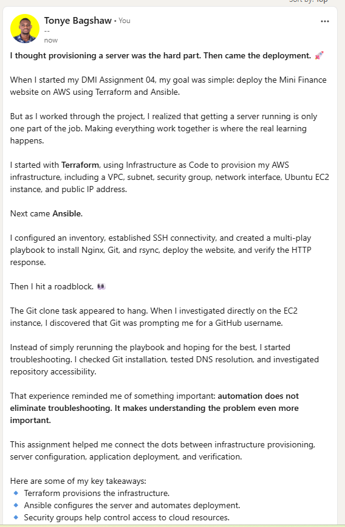

---

#### LinkedIn Post URL

Paste your LinkedIn post URL here:

`https://lnkd.in/p/dDFgyTw8`

---

### LinkedIn Submission Notes

**One challenge you faced and how you fixed it:**

One challenge I faced was during the Git clone task in Ansible. The task appeared to hang because Git prompted for a GitHub username when accessing the Mini Finance repository from my AWS EC2 instance. I investigated the issue by testing Git connectivity directly on the instance and checking repository accessibility. This helped me identify that the repository URL or its access permissions needed further verification before deployment could continue.

---

**One real-world example where you can use this learning:**

I can use this learning to automate the deployment of websites and web applications in a real-world production environment. For example, I can use Terraform to provision AWS infrastructure and Ansible to configure EC2 instances, install Nginx, deploy application files, and verify that the website is running. This reduces manual work, improves consistency, and makes deployments easier to repeat and maintain.

---

# Assignment Questions

Answer the following in your own words:

**1. What did you provision using Terraform in this assignment?**

I used Terraform to provision AWS infrastructure, including a VPC, subnet, security group, network interface, Ubuntu EC2 instance, and public IP address. I also configured security group rules to control SSH and HTTP access to the instance.

---

**2. What did Ansible configure and deploy in this assignment?**

I used Ansible to install Nginx, Git, and rsync on the EC2 instance. I configured Nginx to run automatically, cloned the Mini Finance repository, synchronized the website files to /var/www/html/, set the correct file ownership, and configured a task to verify the deployment.

---

**3. Why is SSH access on port `22` restricted to your public IP address?**

SSH access is restricted to my public IP address to reduce unauthorized access to the EC2 instance. This limits SSH connections to a trusted source instead of exposing remote server administration to the entire internet.

---

**4. Why is HTTP port `80` open to the internet?**

HTTP port 80 is open to the internet so that users can access the deployed Mini Finance website through their web browsers using the EC2 instance's public IP address.

---

**5. What is the purpose of the Ansible inventory file?**

The Ansible inventory file identifies the target EC2 instance and provides the connection details Ansible needs, including the public IP address, SSH username, and private key path. It allows Ansible to connect to the correct server and execute the playbook.

---

**6. Why does the playbook use separate plays for install, deploy, and verify?**

The playbook uses separate plays to organize the deployment into clear stages. The first play prepares the server, the second deploys the website, and the third verifies that the website is accessible. This structure makes the automation easier to understand, maintain, and troubleshoot.

---

**7. Why is `rsync` useful when deploying website files?**

Rsync is useful because it synchronizes files between directories efficiently and transfers only the necessary changes when possible. In this assignment, it copies the Mini Finance website files to the Nginx document root while excluding the .git directory.

---

**8. What does the Ansible `uri` module verify in this assignment?**

The Ansible uri module sends an HTTP request to the deployed website and checks whether the server returns HTTP status code 200. The assert module then confirms that the response status matches the expected value, indicating that the website is responding successfully.

---

**9. What issue did you face during this assignment, and how did you fix it?**

I encountered an issue during the Git clone task because it appeared to hang while attempting to access the Mini Finance repository. When I tested Git access directly on the EC2 instance, Git prompted me for a GitHub username. This indicated that I needed to investigate the repository URL and its access permissions. The issue should only be described as fixed after confirming that the repository can be accessed and the deployment completes successfully.

---

**10. What did you learn from using Terraform and Ansible together?**

I learned how to combine Terraform and Ansible to automate infrastructure provisioning and application deployment on AWS. Terraform creates and manages the cloud infrastructure, while Ansible configures the EC2 instance, installs software, deploys website files, and verifies the result. Using both tools makes the deployment process more consistent, repeatable, and easier to manage.

---

# Required Files

Confirm that the following files are included in your assignment folder:

- [ ] `.gitignore`
- [ ] `README.md`
- [ ] `terraform/providers.tf`
- [ ] `terraform/main.tf`
- [ ] `terraform/variables.tf`
- [ ] `terraform/outputs.tf`
- [ ] `ansible/inventory.ini`
- [ ] `ansible/site.yml`

---

# Submission Instructions

- Add all required screenshots in the correct order.
- Full Name must be visible in required screenshots.
- Add the Azure VM public IP address.
- Add the final Mini Finance website URL.
- Paste `inventory.ini`, `site.yml`, and `README.md` as editable text.
- Answer all assignment questions clearly in your own words.
- Add your LinkedIn post URL.
- Do not expose SSH private keys, passwords, Azure credentials, subscription IDs, Terraform state contents, or other sensitive information.

---

# Completion Checklist

- [ ] Task 1: `mini-finance` project structure created
- [ ] Task 1: `.gitignore` created
- [ ] Task 2: Terraform Azure infrastructure code created
- [ ] Task 2: `Allow-SSH` rule configured for port `22`
- [ ] Task 2: `Allow-HTTP` rule configured for port `80`
- [ ] Task 2: NSG associated with the Network Interface
- [ ] Task 3: `terraform fmt` completed
- [ ] Task 3: `terraform init` completed
- [ ] Task 3: `terraform validate` completed successfully
- [ ] Task 3: `terraform apply` completed successfully
- [ ] Task 3: `terraform output public_ip` displayed the VM public IP
- [ ] Task 4: Passwordless SSH works from the Ansible controller
- [ ] Task 5: `inventory.ini` created
- [ ] Task 5: Ansible ping returns `SUCCESS` and `pong`
- [ ] Task 6: `site.yml` contains three separate plays
- [ ] Task 6: Play 1 installs Nginx, Git, and rsync
- [ ] Task 6: Play 2 clones and deploys the Mini Finance website
- [ ] Task 6: Play 3 verifies HTTP status code `200`
- [ ] Task 7: Playbook syntax check passes
- [ ] Task 7: Ansible playbook completes successfully
- [ ] Task 7: Final recap shows `failed=0` and `unreachable=0`
- [ ] Task 8: Mini Finance website loads in the browser
- [ ] Task 8: Azure VM public IP is visible in the browser screenshot
- [ ] Task 9: `README.md` completed
- [ ] Screenshots 1–15 are included
- [ ] `inventory.ini`, `site.yml`, and `README.md` are pasted as editable text
- [ ] Assignment questions are answered
- [ ] LinkedIn post published with Anyone visibility
- [ ] LinkedIn post URL added
- [ ] No sensitive information is exposed

---

## About DMI & CloudAdvisory

DevOps Micro Internship (DMI) is a project-based DevOps program run by Pravin Mishra and The CloudAdvisory, focused on real-world execution, systems thinking, and career readiness.

It helps learners build strong DevOps foundations with hands-on experience.

---

## Resources

- DMI Official Website: [https://dmi.pravinmishra.com?utm_source=github&utm_medium=readme](https://dmi.pravinmishra.com?utm_source=github&utm_medium=readme)
- University: [https://university.pravinmishra.com?utm_source=github&utm_medium=readme](https://university.pravinmishra.com?utm_source=github&utm_medium=readme)
- Discord Community: [https://discord.pravinmishra.com?utm_source=github&utm_medium=readme](https://discord.pravinmishra.com?utm_source=github&utm_medium=readme)
- Blog: [https://dmi.pravinmishra.com/blog?utm_source=github&utm_medium=readme](https://dmi.pravinmishra.com/blog?utm_source=github&utm_medium=readme)
- YouTube Playlist: [https://www.youtube.com/playlist?list=PLFeSNDtI4Cho](https://www.youtube.com/playlist?list=PLFeSNDtI4Cho)
- Pravin Mishra LinkedIn: [https://www.linkedin.com/in/pravin-mishra-aws-trainer/](https://www.linkedin.com/in/pravin-mishra-aws-trainer/)
- CloudAdvisory LinkedIn: [https://www.linkedin.com/company/thecloudadvisory/](https://www.linkedin.com/company/thecloudadvisory/)

---

*This submission is part of DevOps Micro Internship (DMI) — Agentic AI Track.*