# Assignment — Deploy EpicBook with Terraform and Ansible Roles

Part of the DevOps Micro Internship (DMI) with Agentic AI

---

## Purpose

In this assignment, you will deploy the EpicBook web application using Terraform and Ansible roles.

Terraform provisions the cloud infrastructure, including one Ubuntu VM and one managed MySQL database. Ansible roles configure the VM, install required software, deploy the EpicBook application, configure Nginx, connect the app to the managed MySQL database, and verify the deployment.

---

# Task 1 — Set Up the Project Folder Layout

## Goal

Create the project folder structure for Terraform and Ansible roles.

Terraform will be used to provision the cloud infrastructure. Ansible roles will be used to configure the VM and deploy the EpicBook application.

### Evidence

#### Screenshot 1 — Terminal showing the completed `epicbook-prod` project structure

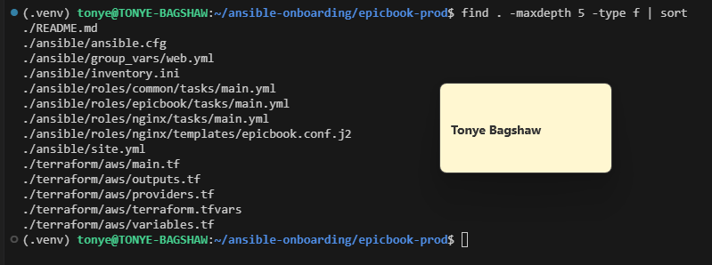

---

### Notes

Answer the following in your own words:

**1. Which cloud provider did you choose for this assignment?**

I chose Amazon Web Services (AWS) as my cloud provider. I used AWS to provision the EC2 instance for hosting the EpicBook application and an RDS MySQL database for storing application data.

---

**2. Why is it useful to keep Terraform files and Ansible files in separate folders?**

Keeping Terraform and Ansible files in separate folders makes the project easier to organize and maintain. Terraform files manage infrastructure provisioning, while Ansible files handle server configuration and application deployment. Separating them makes troubleshooting easier and helps keep each tool focused on its own responsibility.

---

**3. What is the purpose of the `roles` directory in Ansible?**

The roles directory organizes Ansible tasks, variables, templates, and other configuration files into reusable components. In my project, roles such as common, nginx, and epicbook handle different parts of the deployment, making the playbook more modular, readable, and easier to maintain.

---

# Task 2 — Provision the Infrastructure with Terraform

## Goal

Run Terraform to provision the cloud infrastructure for the EpicBook deployment.

Terraform will create the VM, managed MySQL database, networking, security rules, and required outputs.

### Evidence

#### Screenshot 2 — `terraform apply` completed successfully

---

#### Screenshot 3 — Output of `terraform output`

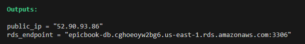

---

#### Screenshot 4 — Azure Portal or AWS Console showing the VM running

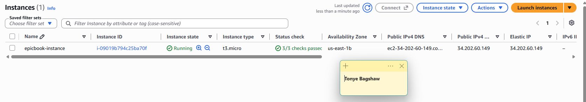
---

#### Screenshot 5 — Azure Portal or AWS Console showing the managed MySQL database created

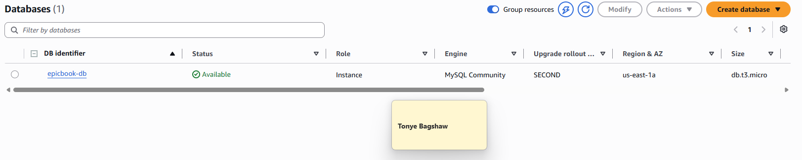

---

### Notes

Answer the following in your own words:

**1. What resources did Terraform create for this assignment?**

Terraform created 14 AWS resources, as shown in the output Apply complete! Resources: 14 added, 0 changed, 0 destroyed. The deployment included an EC2 instance named epicbook-instance for hosting the application and an RDS MySQL database named epicbook-db. The configuration also provisioned supporting infrastructure required for networking and security.

---

**2. Why should you review `terraform plan` before running `terraform apply`?**

I should review terraform plan before running terraform apply to understand what Terraform intends to create, modify, or destroy. This helps me identify configuration errors, avoid unintended infrastructure changes, and check that the proposed resources match the requirements before applying them to AWS.

---

**3. Why should database passwords not be shown in Terraform output?**

Database passwords should not be shown in Terraform output because outputs may be stored, logged, shared, or exposed to unauthorized people. Revealing credentials could allow attackers to access the database. Sensitive values should be protected using Terraform's sensitive settings and secure secrets management, while avoiding committing credentials to GitHub.

---

# Task 3 — Verify SSH Key-Based Access

## Goal

Verify that the cloud VM can be accessed from the Ansible controller using SSH key-based authentication.

### Evidence

#### Screenshot 6 — Successful SSH hostname check from the Ansible controller

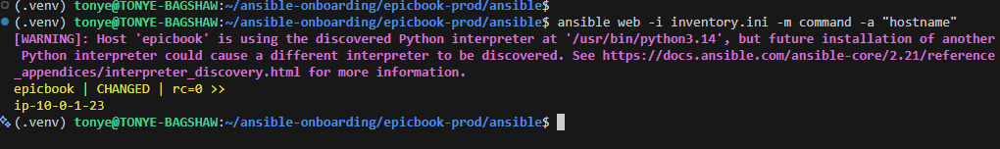

---

### Notes

Answer the following in your own words:

**1. What command did you use to verify SSH access?**

I used the command ansible web -i inventory.ini -m command -a "hostname" to verify that Ansible could connect to the managed EC2 instance and execute a command remotely.

---

**2. What proves that SSH key-based access worked successfully?**

The command executed successfully and returned the hostname ip-10-0-1-23, with the status CHANGED and return code 0. This confirms that Ansible connected to the EC2 instance and executed the command without an SSH password prompt, consistent with successful SSH key-based authentication.

---

**3. What would you check if SSH returned `Permission denied (publickey)`?**

I would check that the SSH username is correct, the private key path in inventory.ini is valid, and the matching public key is installed in the EC2 instance's ~/.ssh/authorized_keys file. I would also verify the private key's file permissions and confirm that the EC2 instance was launched with the corresponding key pair.

---

# Task 4 — Create the Ansible Inventory and Configuration

## Goal

Create the Ansible inventory file and local Ansible configuration for the EpicBook VM.

The inventory tells Ansible which VM to manage and which SSH user to use.

### Evidence

#### Screenshot 7 — `inventory.ini` showing the VM under the `web` group

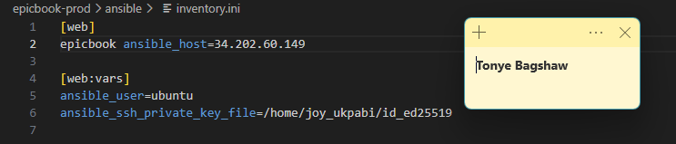

---

#### Screenshot 8 — Output of `ansible-inventory -i inventory.ini --graph`

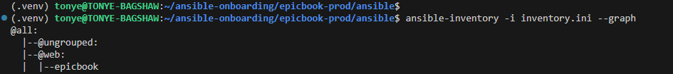

---

#### Screenshot 9 — Output of `ansible web -i inventory.ini -m ping`

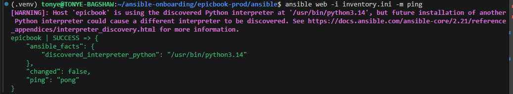

---

### Notes

Answer the following in your own words:

**1. What is the purpose of `inventory.ini`?**

The purpose of inventory.ini is to tell Ansible which servers to manage and how they are grouped. In this deployment, it defines the web group and places the epicbook EC2 instance in that group so Ansible can run tasks against the correct server.

---

**2. What does `ansible_host` store?**

ansible_host stores the IP address or hostname Ansible uses to connect to a managed server. In my inventory, it points to the public IP address 34.202.60.149 of the EpicBook EC2 instance.

---

**3. What does `ansible_ssh_private_key_file` tell Ansible?**

ansible_ssh_private_key_file tells Ansible which private SSH key file to use when authenticating with the managed server. In my configuration, it points to /home/joy_ukpabi/id_ed25519, allowing Ansible to authenticate as the configured SSH user without entering a password each time.

---

**4. Why is `host_key_checking = False` used only for this temporary lab?**

Disabling host key checking allows Ansible to connect without verifying the server's SSH host key against a previously trusted key. This can simplify initial connections in a temporary lab, but it reduces protection against man-in-the-middle attacks. In production, host key checking should remain enabled, and the server's host key should be verified.

---

# Task 5 — Create the Main Ansible Playbook

## Goal

Create the main Ansible playbook that runs the required roles in the correct order.

The `site.yml` file will call the `common`, `nginx`, and `epicbook` roles.

### Evidence

#### Screenshot 10 — `site.yml` showing the roles in the correct order

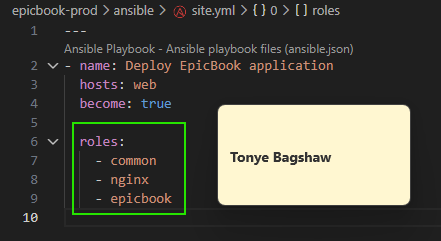

---

#### Screenshot 11 — Output of `ansible-playbook -i inventory.ini site.yml --syntax-check`

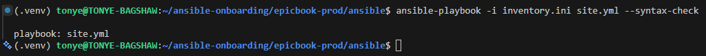

---

### Notes

Answer the following in your own words:

**1. What is the purpose of `site.yml`?**

The purpose of site.yml is to serve as the main Ansible playbook that coordinates the deployment of the EpicBook application. It specifies the target hosts, enables privilege escalation, and defines the roles that Ansible should execute to configure the server and deploy the application.

---

**2. Why should the roles run in the order `common`, `nginx`, and `epicbook`?**

The roles should run in this order because each role prepares part of the environment for the next stage. The common role installs the basic system packages and dependencies, the nginx role installs and configures the web server, and the epicbook role deploys and starts the Node.js application. This order helps ensure that required dependencies and services are prepared before the application deployment.

---

**3. What does `become: true` allow Ansible to do?**

become: true allows Ansible to execute tasks with elevated privileges, usually as the root user through sudo. This is necessary for administrative operations such as installing packages, modifying system configuration files, and managing services like Nginx.

---

# Task 6 — Create the `common` Role

## Goal

Create the `common` role to prepare the Ubuntu VM with the basic packages required for the EpicBook deployment.

This role handles the common server setup before Nginx and the application are configured.

### Evidence

#### Screenshot 12 — `roles/common/tasks/main.yml` showing the common setup tasks

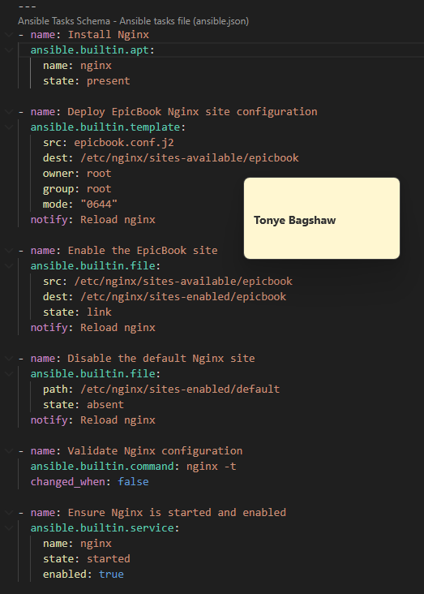

---

### Notes

Answer the following in your own words:

**1. What is the responsibility of the `common` role?**

The common role is responsible for setting up the basic requirements needed by the application server. It handles common system packages and dependencies that other roles need, helping ensure the server is properly prepared before the application is deployed.

---

**2. Why should Nginx installation not be placed inside the `common` role?**

Nginx installation should be handled by a dedicated nginx role because Nginx has its own configuration and service-management requirements. Keeping it separate follows the principle of separation of responsibilities, making the playbook more modular, reusable, and easier to maintain.

---

**3. Why is `mysql-client` useful in this deployment?**

The MySQL client allows the application server to connect to the managed MySQL database, execute SQL queries, check whether tables exist, and import SQL schema files. It enables Ansible tasks to perform database operations from the server without requiring a full MySQL database server to be installed locally.

---

# Task 7 — Create the `nginx` Role

## Goal

Create the `nginx` role to install Nginx and configure it as a reverse proxy for the EpicBook application.

Nginx will receive browser traffic on port `80` and forward it to the EpicBook Node.js application running on the VM.

### Evidence

#### Screenshot 13 — `roles/nginx/tasks/main.yml` showing Nginx installation and site configuration tasks

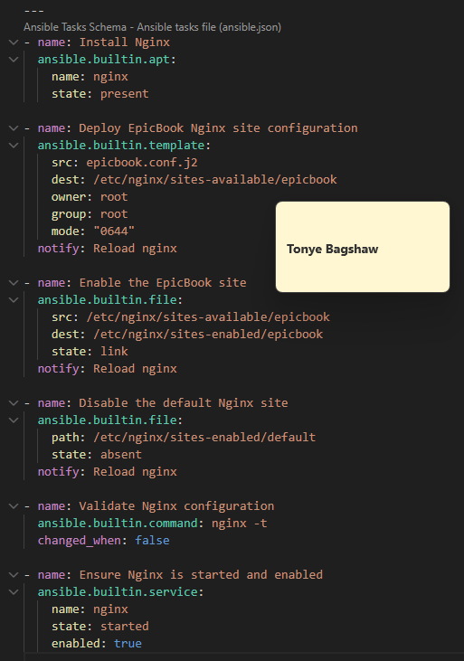

---

#### Screenshot 14 — `roles/nginx/templates/epicbook.conf.j2` showing the reverse proxy configuration

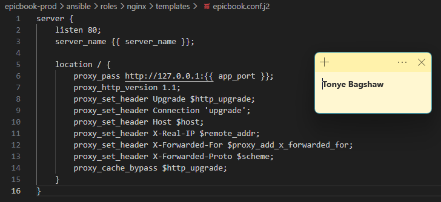

---

### Notes

Answer the following in your own words:

**1. What is the responsibility of the `nginx` role?**

The nginx role is responsible for installing and configuring Nginx for the EpicBook application. It deploys the Nginx site configuration from a template, enables the EpicBook site, disables the default site, validates the configuration using nginx -t, and ensures the Nginx service is running and enabled at startup.

---

**2. Why is Nginx configured as a reverse proxy in this deployment?**

Nginx is configured as a reverse proxy to receive HTTP requests on port 80 and forward them to the EpicBook application running on port 8080 at 127.0.0.1. It also forwards important request headers, such as the original host and client IP information, to the application. This allows users to access the application through Nginx without connecting directly to the application's port.

---

**3. Why should the application port come from `group_vars/web.yml` instead of being hard-coded?**

The application port should come from group_vars/web.yml so that it can be managed centrally and reused across the Ansible configuration. Using the {{ app_port }} variable in the Nginx template makes the deployment easier to maintain and allows the application port to be changed without manually editing the template. It also helps keep the Nginx configuration consistent with the port used by the application.

---

# Task 8 — Create the `epicbook` Role

## Goal

Create the `epicbook` role to deploy the EpicBook application, connect it to the managed MySQL database, and run the application on port `8080` using PM2.

### Evidence

#### Screenshot 15 — `roles/epicbook/tasks/main.yml` showing application deployment tasks

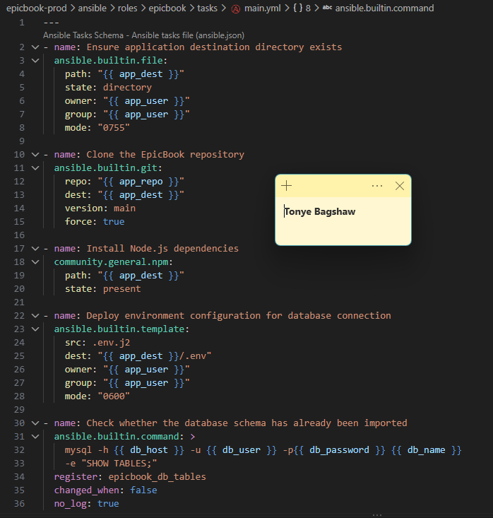

---

#### Screenshot 16 — Task or file showing how the database connection is configured, with secrets hidden

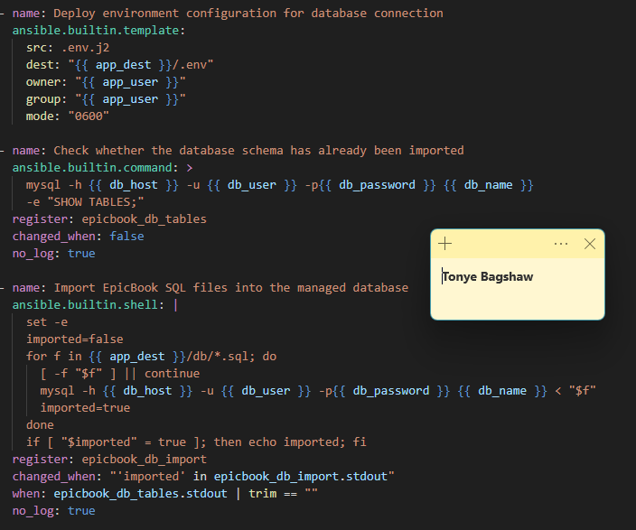

---

#### Screenshot 17 — Task or output showing the EpicBook application managed by PM2

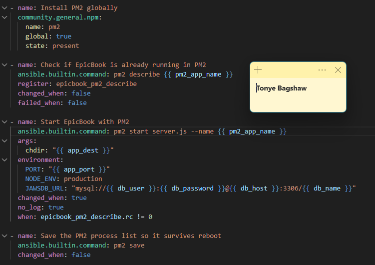

---

### Notes

Answer the following in your own words:

**1. What is the responsibility of the `epicbook` role?**

The epicbook role is responsible for deploying and configuring the EpicBook application on the target server. It creates the application directory, clones the GitHub repository, installs Node.js dependencies, configures the database connection, checks and imports the database schema when needed, installs PM2, starts the application, and saves the PM2 process list.

---

**2. Why is PM2 used for the EpicBook Node.js application?**

PM2 is used to manage the EpicBook Node.js application process. It runs the application in the background, can restart it if it crashes, and helps maintain the application's availability. Saving the PM2 process list also helps restore the application after a server reboot when configured appropriately.

---

**3. Why should database passwords not be hard-coded in public files?**

Database passwords should not be hard-coded in public files because anyone who gains access to those files could obtain the credentials and potentially access or damage the database. Sensitive information should be stored securely using Ansible Vault or a secrets manager and excluded from public repositories.

---

**4. What does it mean for the application to run on port `8080` while Nginx listens on port `80`?**

It means the EpicBook application listens for requests on port 8080, while Nginx receives public HTTP requests on port 80. Nginx can act as a reverse proxy, forwarding incoming requests to the application on port 8080. This allows users to access the application through the standard HTTP port without specifying :8080 in the public URL.

---

# Task 9 — Create Group Variables

## Goal

Create reusable variables for the EpicBook deployment.

The `group_vars/web.yml` file stores values that can be reused across the Ansible roles.

### Evidence

#### Screenshot 18 — `group_vars/web.yml` showing the application, PM2, and database variables, with passwords hidden or masked

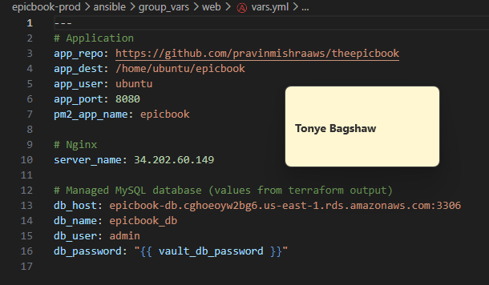

---

### Notes

Answer the following in your own words:

**1. What is the purpose of `group_vars/web.yml`?**

The purpose of group_vars/web.yml is to store configuration variables for hosts in the web inventory group. It keeps configuration separate from Ansible task files, making the deployment easier to manage, maintain, and reuse.

---

**2. Which values did you store in `group_vars/web.yml`?**

I stored the application repository URL, application destination directory, application user, application port (8080), PM2 application name (epicbook), Nginx server name, and managed MySQL database connection settings, including the database host, database name, and database username.

---

**3. How did you handle the database password securely?**

I stored the database password using an Ansible Vault variable named vault_db_password instead of writing the actual password directly in the configuration file. The db_password variable references this encrypted value, and I use the Ansible Vault password when running the playbook to decrypt protected variables.

---

# Task 10 — Run the Ansible Playbook

## Goal

Run the Ansible playbook to configure the VM and deploy the EpicBook application.

The playbook should run the roles in this order:

1. `common`
2. `nginx`
3. `epicbook`

### Evidence

#### Screenshot 19 — Ansible playbook output showing the roles running

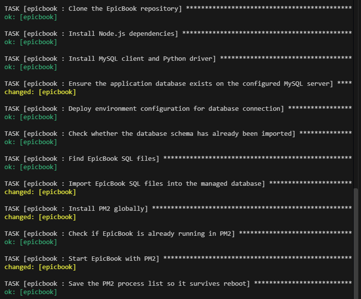

---

#### Screenshot 20 — Final Ansible recap showing `failed=0`

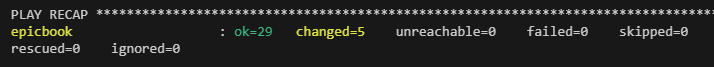

---

#### Screenshot 21 — Output of `ansible web -i inventory.ini -m command -a "systemctl is-active nginx" --become`

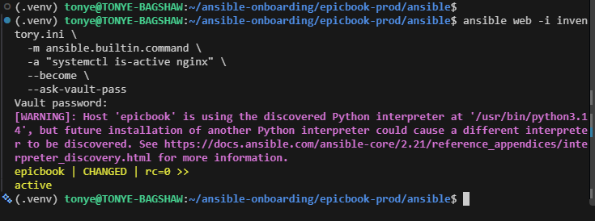

---

#### Screenshot 22 — Output of `ansible web -i inventory.ini -m command -a "pm2 status"`

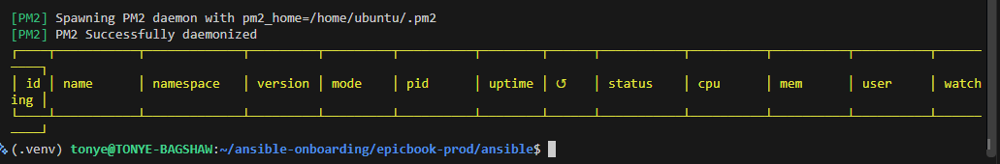

---

#### Screenshot 23 — Output of `ansible web -i inventory.ini -m command -a "curl -I http://localhost:8080"`

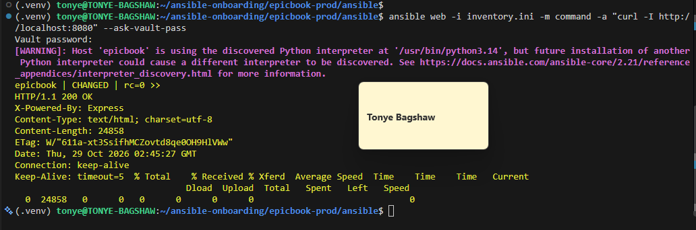

---

### Notes

Answer the following in your own words:

**1. What command did you run to execute the Ansible playbook?**

I ran ansible-playbook -i inventory.ini site.yml --ask-vault-pass to execute the Ansible playbook. The command uses inventory.ini to identify the target hosts, runs the tasks defined in site.yml, and prompts for the Ansible Vault password to decrypt protected variables.

---

**2. How do you know all roles completed successfully?**

The play recap showed ok=29, changed=5, unreachable=0, and failed=0. This confirms that all 29 successful task results were recorded, five tasks made changes, and no tasks failed or hosts became unreachable.

---

**3. What proves that Nginx is active?**

I ran ansible web -i inventory.ini -m ansible.builtin.command -a "systemctl is-active nginx" --become --ask-vault-pass. The output returned active, confirming that the Nginx service was running on the target host.

---

**4. What proves that PM2 is managing the EpicBook application?**

The playbook successfully executed the tasks to install PM2, start EpicBook with PM2, and save the PM2 process list. However, the displayed PM2 output showed an empty process table, so that screenshot alone does not confirm that EpicBook was actively managed by PM2 at that moment.

---

**5. What proves that the EpicBook application responds on port `8080`?**

I ran curl -I http://localhost:8080 on the target host. The response returned HTTP/1.1 200 OK with the X-Powered-By: Express header, confirming that an HTTP service responded successfully on port 8080 and that the response identified Express as the application framework.

---

# Task 11 — Verify the EpicBook Deployment

## Goal

Verify that the EpicBook application is running, accessible in the browser, and connected to the managed MySQL database.

### Evidence

#### Screenshot 24 — Output of `curl -I http://<public_ip>`

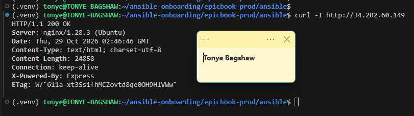

---

#### Screenshot 25 — Output of the cart API test command

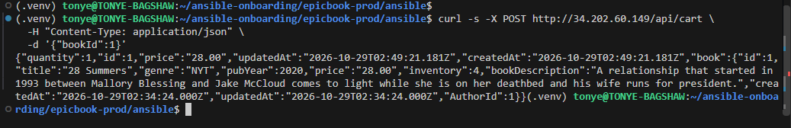

---

#### Screenshot 26 — Output of the `/cart` HTTP status check

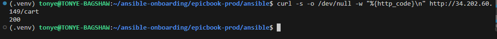

---

#### Screenshot 27 — Browser showing the EpicBook application loaded from `http://<public_ip>`

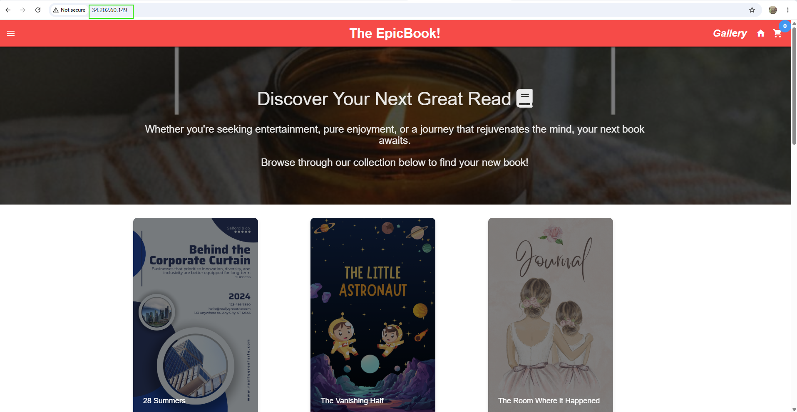

---

### Notes

Answer the following in your own words:

**1. What HTTP response did you receive from the public application URL?**

I received an HTTP 200 OK response from the public application URL. The response headers showed that Nginx was serving the application, confirming that the public URL was accessible.

---

**2. What did the cart API test prove?**

The cart API test successfully created a cart item using a POST request to /api/cart. The API returned a JSON response containing the cart item details, including its quantity, price, book information, and ID. This confirmed that the cart endpoint was working and processing requests successfully.

---

**3. What did the `/cart` status check return?**

The /cart status check returned HTTP status code 200, confirming that the public /cart route was accessible and responding successfully.

---

**4. What issue did you face during verification, and how did you fix it?**

During verification, I needed to confirm that the public application URL, cart API endpoint, and cart page were responding correctly. I used curl commands to test the HTTP status and send a POST request to the cart API. The tests returned HTTP 200 OK, and the cart API returned the created item as JSON, confirming that the endpoints were functioning as expected.

---

# LinkedIn Post Required

## Evidence

#### LinkedIn Post URL

Paste your LinkedIn post URL here:

`https://lnkd.in/p/dnWSP9Xz`

---

#### Screenshot — Published LinkedIn post

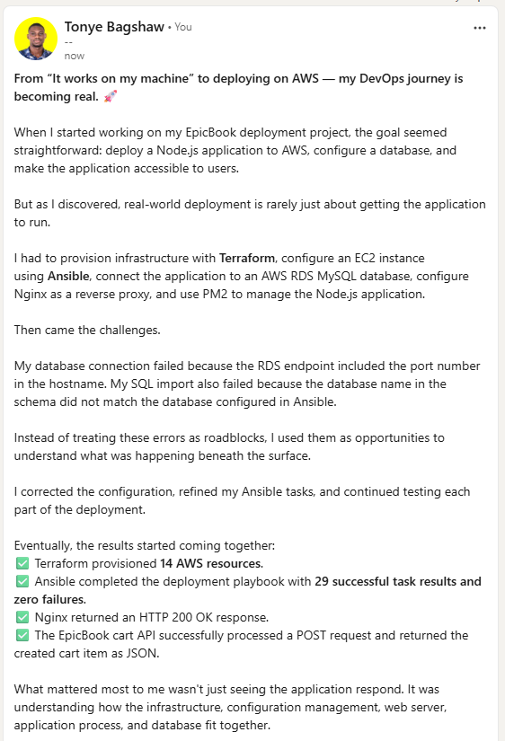

---

# Assignment Questions

Answer the following in your own words:

**1. Why is Terraform used for infrastructure provisioning?**

Terraform is used to create and manage infrastructure automatically through code. It helps provision resources such as EC2 instances, VPCs, security groups, and RDS databases consistently and reduces the need to configure everything manually.

---

**2. Why are Ansible roles useful for production-style deployments?**

Ansible roles organize deployment tasks, variables, templates, and handlers into reusable components. This makes the project easier to maintain, troubleshoot, and reuse across different environments.

---

**3. What is the purpose of `group_vars/web.yml`?**

The group_vars/web.yml file stores variables that apply to hosts in the web inventory group. It helps keep configuration separate from task files, making it easier to manage settings such as application ports, package names, and deployment options.

---

**4. Why should database passwords not be committed to GitHub?**

Database passwords should not be committed to GitHub because unauthorized people could access the credentials and use them to connect to the database. This could lead to data theft, modification, or deletion. Sensitive credentials should be stored securely using Ansible Vault or a secrets manager.

---

**5. What is the purpose of Nginx in this deployment?**

Nginx acts as a web server and can serve as a reverse proxy for the EpicBook Node.js application. It receives HTTP requests from users and forwards them to the application running on its configured backend port. It can also help manage incoming traffic and serve static files.

---

**6. Why should the managed MySQL database not be publicly accessible?**

The managed MySQL database should not be publicly accessible because exposing it to the internet increases the risk of unauthorized access and attacks. Keeping it in a private network and allowing connections only from authorized application servers reduces the attack surface.

---

**7. Why is PM2 used for the EpicBook Node.js application?**

PM2 is used to manage the EpicBook Node.js application process. It can restart the application if it crashes, run it in the background, manage application logs, and restore saved processes after a server reboot when configured appropriately.

---

**8. What does idempotency mean in Ansible?**

Idempotency means that running an Ansible playbook multiple times should produce the same desired system state without repeatedly making unnecessary changes. For example, if Nginx is already installed, Ansible should leave it installed rather than reinstalling it every time.

---

**9. What issue did you face during the deployment, and how did you fix it?**

One issue I faced was a database connection and schema import failure. The database hostname initially included the port number, which caused a hostname resolution error. I corrected the configuration by separating the database hostname from port 3306. I also discovered that the SQL schema referenced a database named bookstore, while the Ansible configuration used epicbook_db. This required aligning the database name across the Ansible variables, SQL files, and application configuration.

---

**10. What security improvement would you make before using this setup in production?**

I would improve secrets management by storing database credentials in AWS Secrets Manager or Ansible Vault, rotating any exposed credentials, and ensuring secrets are never committed to GitHub. I would also restrict SSH access, keep the database in private subnets, apply least-privilege IAM permissions, and configure security groups to allow only necessary traffic.

---

# Required Files

Confirm that the following files are included in your GitHub repository or assignment folder:

- [ ] `README.md`
- [ ] Terraform files under either `terraform/azure/` or `terraform/aws/`
- [ ] `ansible/ansible.cfg`
- [ ] `ansible/inventory.ini`
- [ ] `ansible/site.yml`
- [ ] `ansible/group_vars/web.yml`
- [ ] `ansible/roles/common/tasks/main.yml`
- [ ] `ansible/roles/nginx/tasks/main.yml`
- [ ] `ansible/roles/nginx/templates/epicbook.conf.j2`
- [ ] `ansible/roles/epicbook/tasks/main.yml`

---

# Submission Instructions

- Add all required screenshots in your submission.
- Full Name must be visible in required screenshots.
- Mention the cloud provider used: Azure or AWS.
- Add the VM public IP address.
- Add the final application URL.
- Add Terraform output proof.
- Add Ansible role tree proof.
- Add all required notes and assignment question answers.
- Add your LinkedIn post URL.
- Do not expose SSH private keys, passwords, cloud credentials, database credentials, Terraform state files, subscription IDs, or account IDs.

---

# Completion Checklist

- [ ] Task 1: Project folder layout created
- [ ] Task 2: Terraform infrastructure provisioned
- [ ] Task 3: SSH key-based access verified
- [ ] Task 4: Ansible inventory and configuration created
- [ ] Task 5: Main Ansible playbook created
- [ ] Task 6: `common` role created
- [ ] Task 7: `nginx` role created
- [ ] Task 8: `epicbook` role created
- [ ] Task 9: Group variables created
- [ ] Task 10: Ansible playbook run completed
- [ ] Task 11: EpicBook deployment verified
- [ ] Terraform files created under only one cloud provider folder
- [ ] One Ubuntu VM was created
- [ ] One managed MySQL database was created
- [ ] SSH port `22` is restricted to the controller public IP
- [ ] HTTP port `80` is accessible
- [ ] MySQL port `3306` is not publicly open
- [ ] `ansible web -i inventory.ini -m ping` returns `SUCCESS`
- [ ] `site.yml` calls the roles in the correct order
- [ ] Database secrets are hidden or handled securely
- [ ] Nginx is active
- [ ] PM2 shows the EpicBook application running
- [ ] EpicBook responds on port `8080`
- [ ] Public URL loads in the browser
- [ ] Cart API verification works
- [ ] Playbook completes with `failed=0`
- [ ] Screenshots 1–27 are included
- [ ] Assignment questions are answered
- [ ] LinkedIn post published
- [ ] LinkedIn post URL added
- [ ] No sensitive information is exposed

---

## About DMI & CloudAdvisory

DevOps Micro Internship (DMI) is a project-based DevOps program run by Pravin Mishra and The CloudAdvisory, focused on real-world execution, systems thinking, and career readiness.

It helps learners build strong DevOps foundations with hands-on experience.

---

## Resources

- DMI Official Website: [https://dmi.pravinmishra.com?utm_source=github&utm_medium=readme](https://dmi.pravinmishra.com?utm_source=github&utm_medium=readme)
- University: [https://university.pravinmishra.com?utm_source=github&utm_medium=readme](https://university.pravinmishra.com?utm_source=github&utm_medium=readme)
- Discord Community: [https://discord.pravinmishra.com?utm_source=github&utm_medium=readme](https://discord.pravinmishra.com?utm_source=github&utm_medium=readme)
- Blog: [https://dmi.pravinmishra.com/blog?utm_source=github&utm_medium=readme](https://dmi.pravinmishra.com/blog?utm_source=github&utm_medium=readme)
- YouTube Playlist: [https://www.youtube.com/playlist?list=PLFeSNDtI4Cho](https://www.youtube.com/playlist?list=PLFeSNDtI4Cho)
- Pravin Mishra LinkedIn: [https://www.linkedin.com/in/pravin-mishra-aws-trainer/](https://www.linkedin.com/in/pravin-mishra-aws-trainer/)
- CloudAdvisory LinkedIn: [https://www.linkedin.com/company/thecloudadvisory/](https://www.linkedin.com/company/thecloudadvisory/)

---

*This submission is part of DevOps Micro Internship (DMI) — Agentic AI Track.*