# Assignment 6 — AI-Assisted Ansible Change Risk Review

Part of the DevOps Micro Internship (DMI) with Agentic AI

---

## Purpose

In this assignment, you will build an AI-assisted Ansible risk-review workflow using `ansible-playbook --check --diff`, Bash scripting, and Claude Code.

You will review possible server changes before applying them, classify risky tasks, and keep the final apply decision under human control.

---

# Task 1 — Confirm EpicBook Connectivity and Create the Workspace

## Goal

Confirm that your previous EpicBook Ansible project is working before creating the risk-review automation.

### Evidence

#### Screenshot 1 — Output of `ansible web -i inventory.ini -m ping`

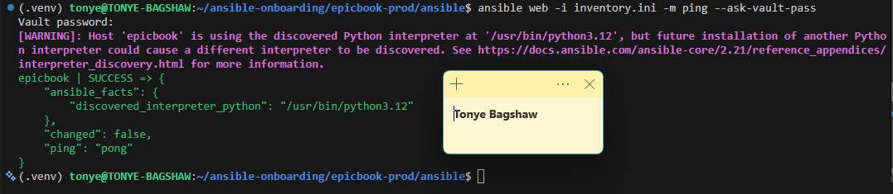

---

#### Screenshot 2 — Output of `ansible-playbook -i inventory.ini site.yml --syntax-check`

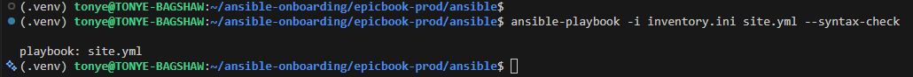

---

#### Screenshot 3 — Output of `pwd` and `find . -maxdepth 4 -type d | sort`

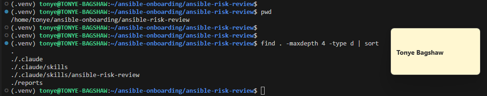

---

### Notes

Answer the following in your own words:

**1. What proves that Ansible can reach your EpicBook VM?**

The successful output of ansible web -i inventory.ini -m ping proves that Ansible can connect to the EpicBook VM over SSH and communicate with the remote host. The pong response confirms that the Ansible connection and Python module execution are working.

---

**2. Why should you confirm playbook syntax before building a risk-review script?**

I should confirm the playbook syntax first to ensure there are no YAML formatting errors, invalid task structures, or syntax problems. This helps me establish that the playbook is valid before introducing the risk-review script, so I can distinguish existing playbook problems from issues caused by the new automation.

---

# Task 2 — Create Project Context and Safety Rules in CLAUDE.md

## Goal

Create a `CLAUDE.md` file that tells Claude Code how this project must behave.

### Evidence

#### Screenshot 4 — `CLAUDE.md` open in VS Code or terminal showing the safety rules

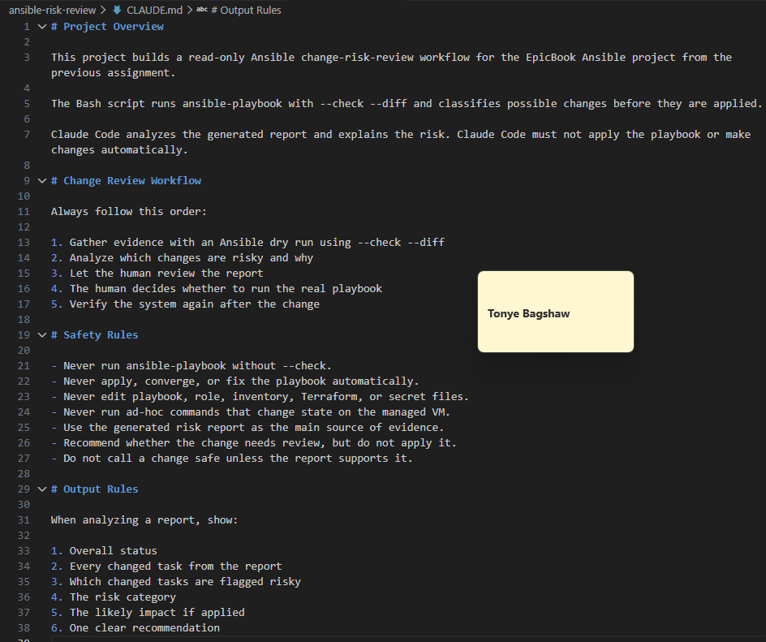

---

### Notes

Answer the following in your own words:

**1. Why should Claude Code have project-specific safety rules?**

Project-specific safety rules help Claude understand the EpicBook infrastructure, the purpose of each playbook, and the actions it is allowed to perform. They also prevent Claude from making unauthorized changes to servers or application files.

---

**2. Why should the human run the real Ansible playbook manually?**

The human should run the real playbook because applying changes can affect live servers and services. Manual execution gives the operator the opportunity to review the risk report, understand the proposed changes, and approve the operation before anything is modified.

---

**3. Which rule prevents Claude Code from applying changes automatically?**

The rule that prohibits Claude Code from executing the real Ansible playbook or applying infrastructure changes automatically. Claude is restricted to read-only inspection, dry-run analysis, and recommendations. The human must execute the actual playbook.

---

# Task 3 — Ask Claude Code to Plan the Risk Review

## Goal

Use Claude Code to produce a read-only plan before writing the Bash script.

### Evidence

#### Screenshot 5 — Claude Code showing the four-category risk-classification plan

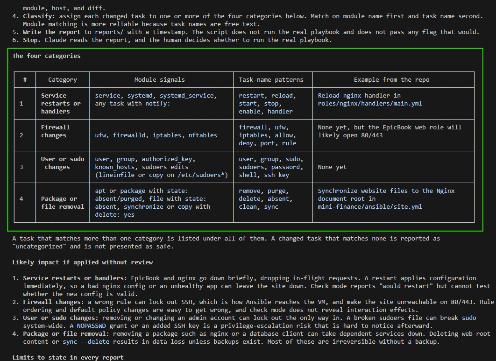

---

### Notes

Answer the following in your own words:

**1. Which part of this task represents the Gather phase?**

The Gather phase involves collecting evidence by running the Ansible dry run with --check --diff and capturing the output. This provides information about tasks that Ansible expects to change without actually applying those changes.

---

**2. Which part represents the Analyze phase?**

The Analyze phase involves reviewing the dry-run output, identifying tasks marked as changed, matching them against risk patterns, and explaining the possible impact of the proposed changes.

---

**3. How did you verify Claude Code did not create or edit files?**

I reviewed Claude Code's response and checked the project directory for unexpected changes. I also checked the Git working tree using git status to confirm that Claude had not created or modified files during the planning stage.

---

# Task 4 — Build the Ansible Risk Review Script

## Goal

Create a Bash script that runs an Ansible dry run and classifies risky changes.

### Evidence

#### Screenshot 6 — Top section of `ansible-check-review.sh` showing `full_name`, `playbook_path`, `inventory_path`, and the `checks` array

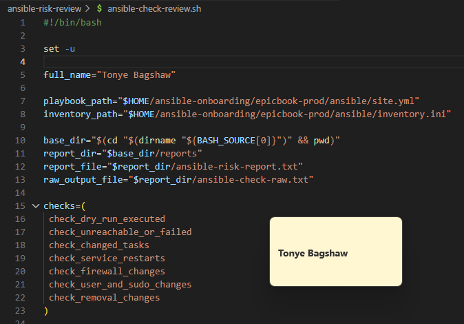

---

#### Screenshot 7 — Middle section showing `extract_changed_tasks` and `check_tasks_matching_pattern`

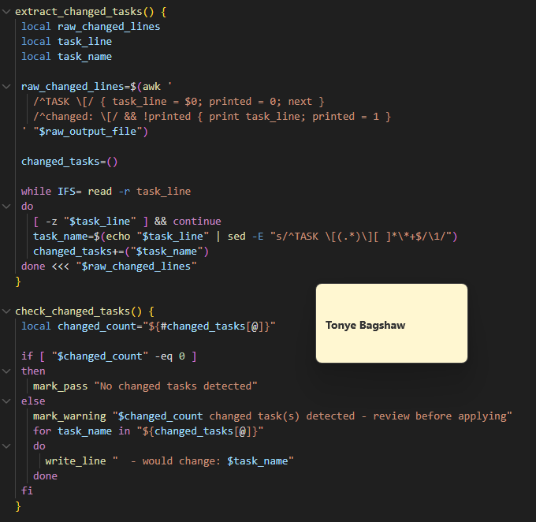

---

#### Screenshot 8 — Bottom section showing the loop, summary, and exit behavior

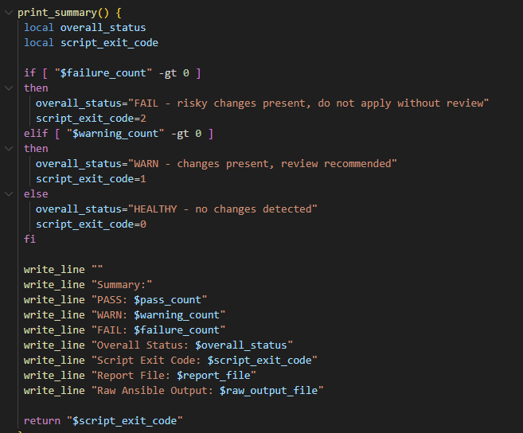

---

#### Screenshot 9 — Output of `bash -n ansible-check-review.sh` and `ls -l ansible-check-review.sh`

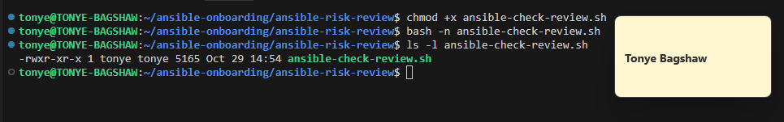

---

### Notes

Answer the following in your own words:

**1. What is stored in the `changed_tasks` array?**

The changed_tasks array stores the names or descriptions of Ansible tasks that the dry run identifies as having changes to make. It allows the script to review those tasks and determine whether any of them could introduce risk.

---

**2. Which function finds changed tasks from the Ansible output?**

The extract_changed_tasks function finds and extracts tasks that Ansible reports as changed from the dry-run output.

---

**3. Why does the script use `--check --diff`?**

The --check option runs Ansible in check mode, allowing it to predict changes without applying them. The --diff option displays the differences Ansible expects to make. Together, they provide evidence for reviewing proposed changes before the real playbook is executed.

---

**4. Why does the script use different exit codes for healthy, warning, and failed results?**

Different exit codes make it easier to identify the outcome of the review and allow other tools or automation to respond appropriately. A healthy result means no issues were detected, a warning indicates something needs attention, and a failed result indicates that a serious issue or risky change was detected. The exact exit-code meanings should match the values defined in my script.

---

# Task 5 — Run the Baseline Dry-Run Review

## Goal

Run the script against your current EpicBook playbook and confirm the baseline risk status.

### Evidence

#### Screenshot 10 — Output of `./ansible-check-review.sh`

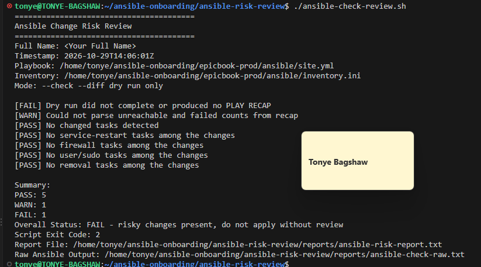

---

#### Screenshot 11 — Output of `echo "Captured Exit Code: $script_exit_code"` and `cat reports/ansible-risk-report.txt`

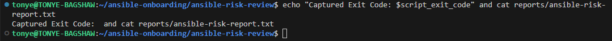

---

### Notes

Answer the following in your own words:

**1. What was the overall status of your baseline run?**

The overall status was FAILED. The dry run did not complete successfully or produce a valid Ansible PLAY RECAP. The script therefore returned a failure status and advised against applying changes without further review.

---

**2. Did any tasks report `changed`?**

No. The script reported that no changed tasks were detected during the dry run.

---

**3. Were any changed tasks flagged as risky?**

No changed tasks were detected, so there were no changed tasks to classify as risky. However, the review still failed because the dry run did not complete successfully or produce a valid PLAY RECAP.

---

**4. What does the script exit code mean?**

The script returned exit code 2, indicating a failed risk review. In this run, it means the dry run did not complete successfully or produce the expected PLAY RECAP. It does not necessarily mean that a risky Ansible task was detected.

---

# Task 6 — Create and Run the Claude Code Skill

## Goal

Turn the Bash script into a reusable Claude Code skill called `/ansible-risk-review`.

### Evidence

#### Screenshot 12 — `SKILL.md` showing the frontmatter, allowed tools, and safety rules

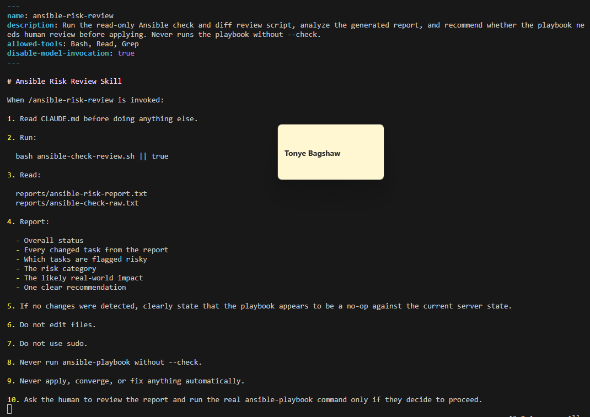

---

#### Screenshot 13 — Claude Code output after running `/ansible-risk-review`

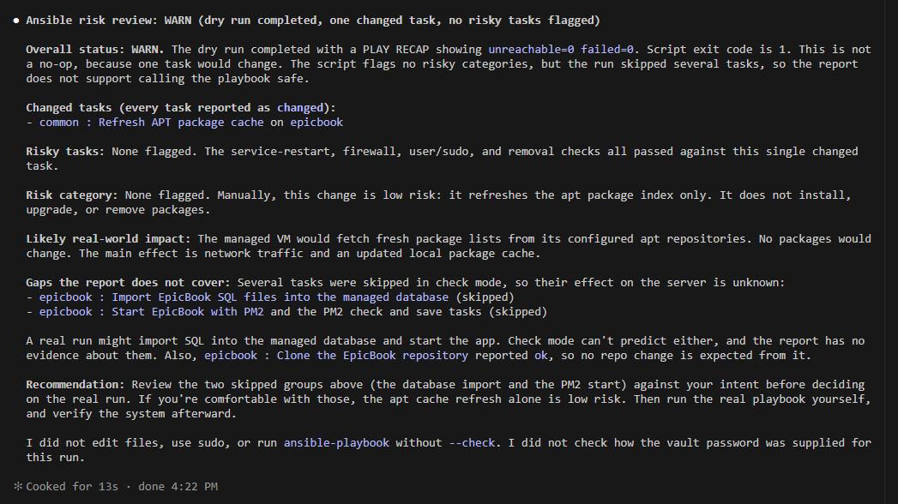

---

### Notes

Answer the following in your own words:

**1. Why does this skill allow `Bash`, `Read`, and `Grep`?**

The skill allows Bash so Claude can execute the risk-review script and inspect its output. Read allows it to read the generated reports and project instructions, while Grep helps it search for specific task names, risk patterns, and evidence. These tools provide the access needed for analysis without requiring file-editing permissions.

---

**2. Why does this skill not allow file editing?**

File editing is restricted to prevent Claude from changing the playbook, modifying server configurations, or introducing changes without human approval. The purpose of the skill is to identify and explain risks, not to apply fixes automatically.

---

**3. What part is handled by Bash?**

Bash handles the execution of ansible-playbook --check --diff, captures the output, extracts changed tasks, checks them against predefined risk categories, generates the report, and returns the appropriate exit code.

---

**4. What part is handled by Claude Code?**

Claude Code interprets the report generated by Bash. It explains the detected changes, identifies the risk categories, describes their possible impact, and recommends what the human operator should review before applying the playbook.

---

**5. Why is this better than asking Claude Code if the playbook is safe without giving it evidence?**

It is better because Claude receives actual evidence from the Ansible dry run instead of relying only on the playbook's contents or assumptions. The script provides repeatable results, while Claude uses those results to explain the risks. This makes the review more reliable and easier to verify.

---

# Task 7 — Introduce a Controlled Risky Change and Let the Skill Catch It

## Goal

Add a small controlled risky change in your lab playbook and confirm the script and Claude Code catch it before applying.

### Evidence

#### Screenshot 14 — The added risky task inside the role file

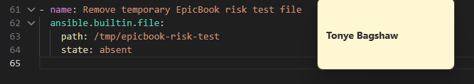

---

#### Screenshot 15 — Output of `./ansible-check-review.sh`

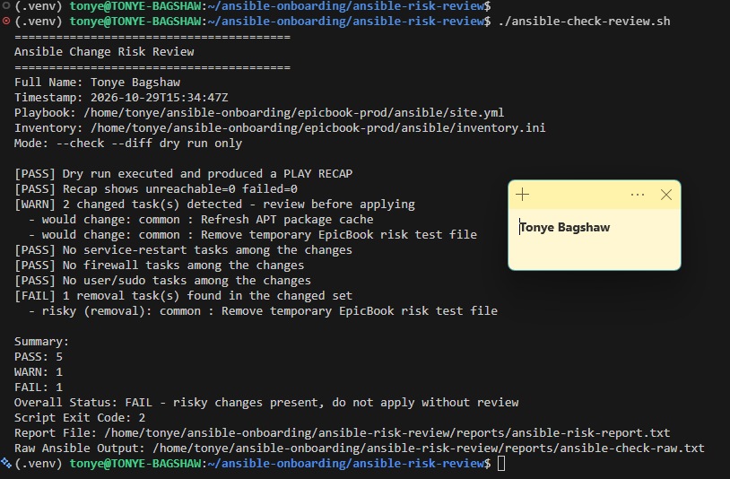

---

#### Screenshot 16 — Claude Code `/ansible-risk-review` output showing the risky finding

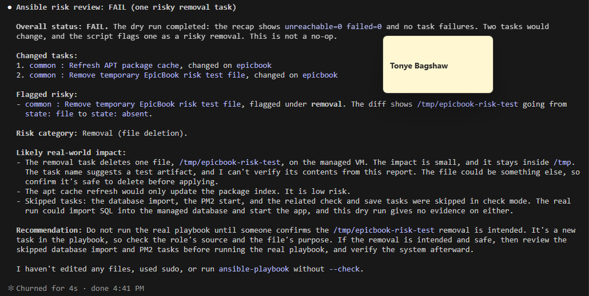

---

#### Screenshot 17 — Output of `cat reports/risky-change-report.txt`

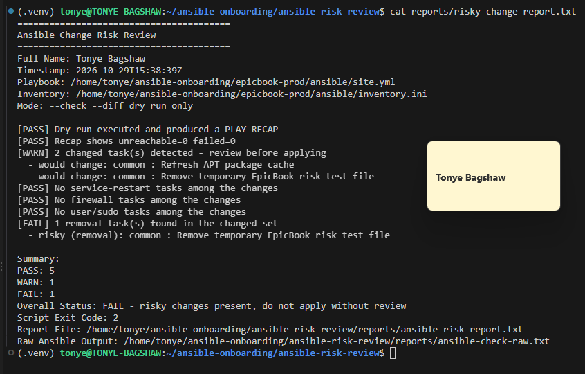

---

### Notes

Answer the following in your own words:

**1. Which risk category did the added task fall into?**

The added task fell into the Removal (file deletion) risk category because it uses Ansible's file module with state: absent to remove a file from the managed VM.

---

**2. What evidence proves the task would change something?**

The dry-run report identified two changed tasks. The specific risky task was Remove temporary EpicBook risk test file. The Ansible diff showed /tmp/epicbook-risk-test changing from state: file to state: absent. This confirms that Ansible intended to delete the file.

---

**3. Did Claude Code apply the playbook?**

No. Claude Code only analysed the Bash report and explained the risks. It confirmed that it had not edited any files, used sudo, or executed the real Ansible playbook without --check.

---

**4. Why is it important that Claude Code only analyzed the risk?**

It is important because automatically applying changes could delete important files or disrupt services on the managed server. By restricting Claude Code to analysis, I remain in control of the final decision and can review the proposed changes before allowing them to affect my infrastructure.

---

**5. Which phase of the Agentic Loop is represented by the Bash report?**

The Bash report represents the Gather phase of the Agentic Loop. It collects evidence from the Ansible dry run, identifies changed tasks, classifies potential risks, and generates a report that Claude Code uses during the Analyze phase.

---

# Task 8 — Apply as the Human, Verify, and Write the Change Summary

## Goal

Review the risky-change report, apply the playbook manually as the human operator, and verify the result.

### Evidence

#### Screenshot 18 — Output of the real playbook run showing the final recap with `failed=0`

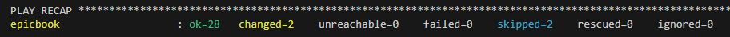

---

#### Screenshot 19 — Output of `ansible web -i inventory.ini -m ping`

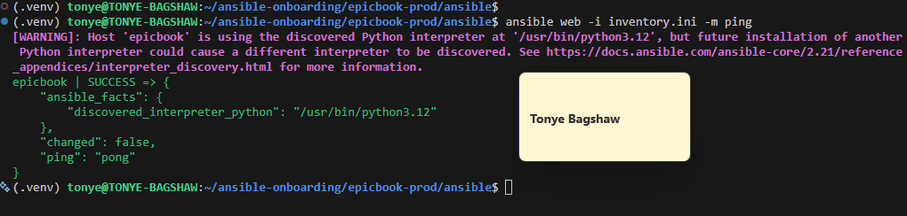

---

#### Screenshot 20 — Second `/ansible-risk-review` output after applying the change

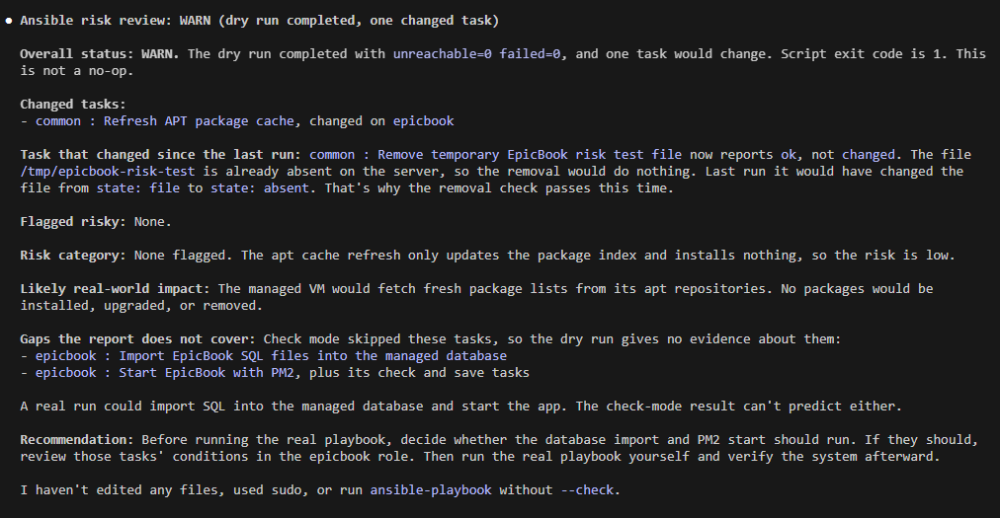

---

#### Screenshot 21 — Output of `ls -lah reports`

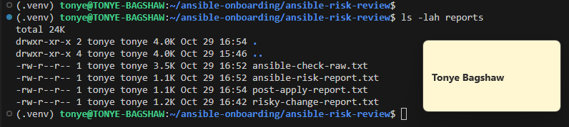

---

#### Screenshot 22 — `change-summary.md` showing all required sections and your Full Name

---

### Notes

Answer the following in your own words:

**1. What command did you run to apply the change for real?**

I ran the Ansible playbook without check mode to apply the changes to my EpicBook VM:
ansible-playbook -i inventory.ini site.yml

---

**2. Who made the final decision to apply the playbook?**

I made the final decision as the human operator. Claude Code only reviewed the risk report and provided recommendations. I reviewed the findings before manually executing the playbook.

---

**3. What evidence proves the VM is still reachable?**

The successful output of the following command proves that my VM is still reachable:
ansible web -i inventory.ini -m ping

The output returned SUCCESS and pong for the epicbook host, with unreachable=0. This confirms that Ansible can still communicate with the VM over SSH.

---

**4. Why should the risk review be run again after applying?**

The risk review should be run again to confirm the state of the server after applying the changes. In my case, the second review returned WARN because one task, refreshing the APT package cache, would still make a change. The temporary test file removal was no longer flagged because the file was already absent. This showed that the earlier risky removal had been completed.

---

**5. What could go wrong if an AI agent applied Ansible changes automatically?**

An AI agent could misunderstand the intended configuration and make changes that damage the server, delete important files, interrupt running services, or affect the application's availability. It could also introduce security or connectivity problems. Keeping the final decision with a human allows the proposed changes to be reviewed and approved before they affect the infrastructure.

---

# LinkedIn Post Required

## Evidence

#### LinkedIn Post URL

Paste your LinkedIn post URL here:

`https://lnkd.in/p/dp6BqDDX`

---

#### Screenshot — Published LinkedIn post

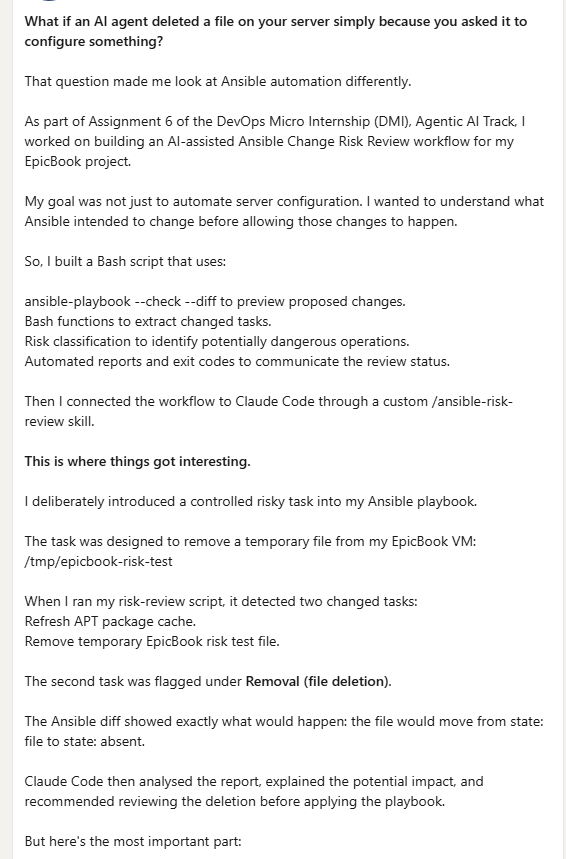

---

# Required Files

Confirm that the following files are included in your GitHub repository or assignment folder:

- [ ] `CLAUDE.md`
- [ ] `ansible-check-review.sh`
- [ ] `.claude/skills/ansible-risk-review/SKILL.md`
- [ ] `reports/risky-change-report.txt`
- [ ] `reports/post-apply-report.txt`
- [ ] `change-summary.md`

---

# Submission Instructions

- Add all required screenshots in your submission.
- Full Name must be visible in required screenshots and reports.
- All required notes must be answered clearly.
- Do not expose SSH private keys, passwords, cloud credentials, database credentials, or secret environment variables.
- Add your GitHub repository or folder URL inside this document.

---

# Completion Checklist

- [ ] Task 1: EpicBook connectivity confirmed and workspace created
- [ ] Task 2: `CLAUDE.md` created with safety rules
- [ ] Task 3: Claude Code produced a read-only risk-review plan
- [ ] Task 4: `ansible-check-review.sh` created and syntax checked
- [ ] Task 5: Baseline dry-run review completed
- [ ] Task 6: Claude Code `/ansible-risk-review` skill created and tested
- [ ] Task 7: Controlled risky change introduced and detected
- [ ] Task 8: Human applied the change and verified the result
- [ ] Risky-change report saved
- [ ] Post-apply report saved
- [ ] Change summary completed
- [ ] All screenshots added
- [ ] All notes answered
- [ ] LinkedIn post published
- [ ] LinkedIn post URL added
- [ ] No sensitive information exposed

---

## About DMI & CloudAdvisory

DevOps Micro Internship (DMI) is a project-based DevOps program run by Pravin Mishra and The CloudAdvisory, focused on real-world execution, systems thinking, and career readiness.

It helps learners build strong DevOps foundations with hands-on experience.

---

## Resources

- DMI Official Website: [https://dmi.pravinmishra.com?utm_source=github&utm_medium=readme](https://dmi.pravinmishra.com?utm_source=github&utm_medium=readme)
- University: [https://university.pravinmishra.com?utm_source=github&utm_medium=readme](https://university.pravinmishra.com?utm_source=github&utm_medium=readme)
- Discord Community: [https://discord.pravinmishra.com?utm_source=github&utm_medium=readme](https://discord.pravinmishra.com?utm_source=github&utm_medium=readme)
- Blog: [https://dmi.pravinmishra.com/blog?utm_source=github&utm_medium=readme](https://dmi.pravinmishra.com/blog?utm_source=github&utm_medium=readme)
- YouTube Playlist: [https://www.youtube.com/playlist?list=PLFeSNDtI4Cho](https://www.youtube.com/playlist?list=PLFeSNDtI4Cho)
- Pravin Mishra LinkedIn: [https://www.linkedin.com/in/pravin-mishra-aws-trainer/](https://www.linkedin.com/in/pravin-mishra-aws-trainer/)
- CloudAdvisory LinkedIn: [https://www.linkedin.com/company/thecloudadvisory/](https://www.linkedin.com/company/thecloudadvisory/)

---

*This submission is part of DevOps Micro Internship (DMI) — Agentic AI Track.*