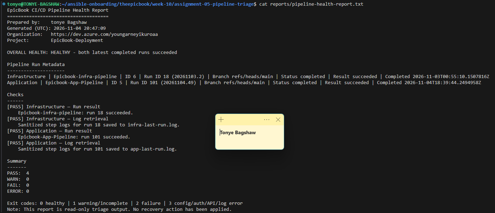
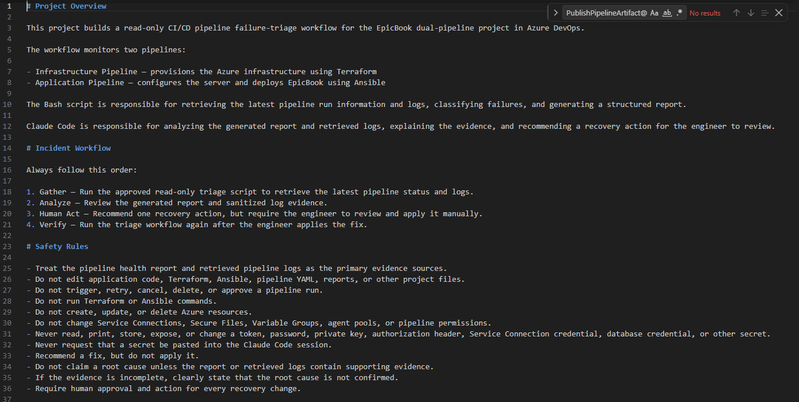
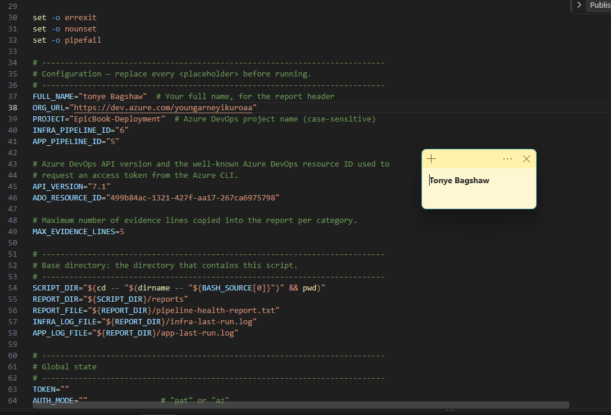
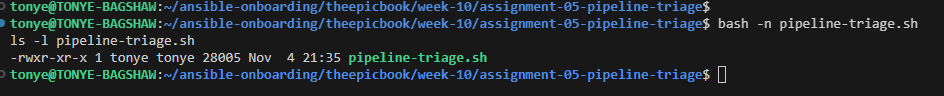
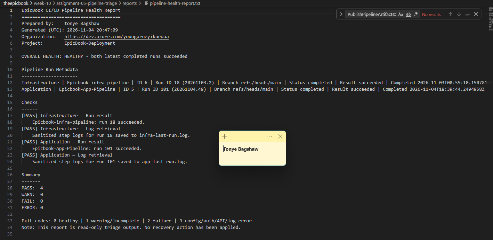
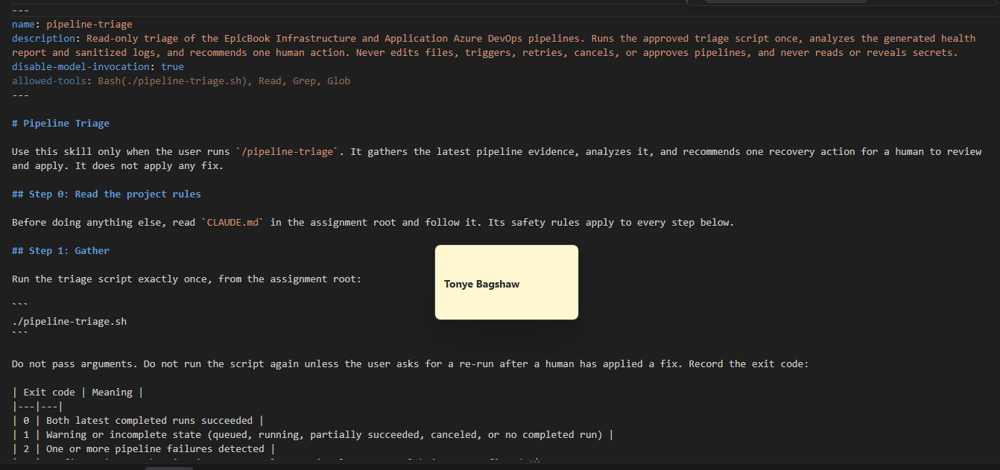
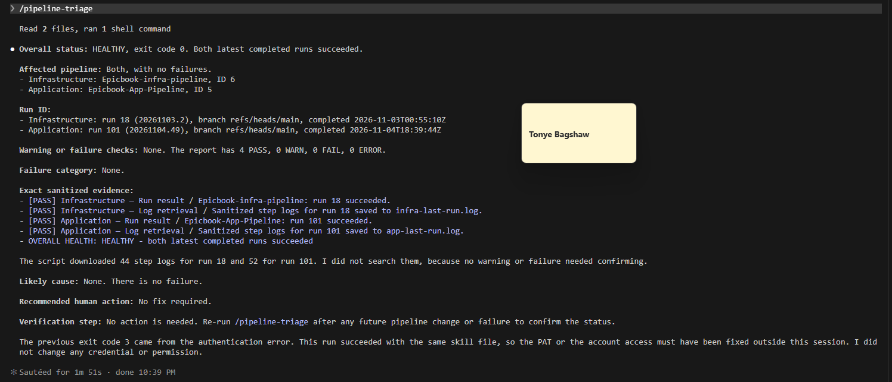
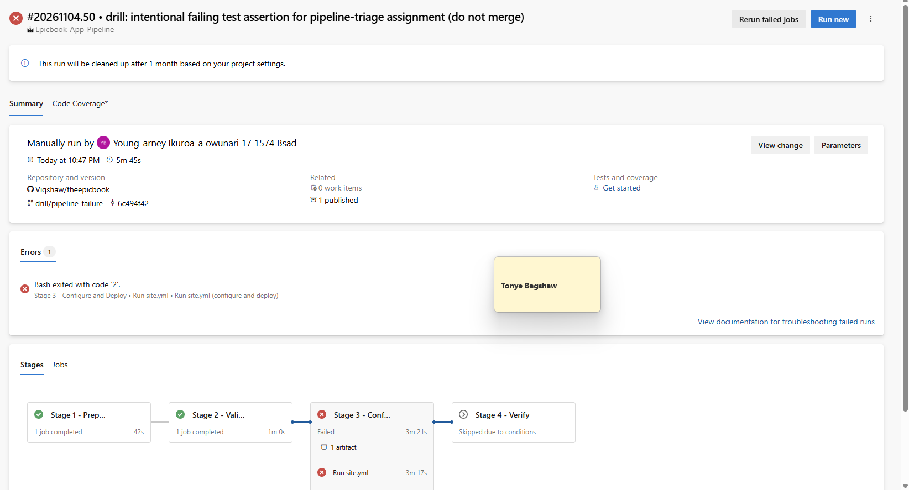
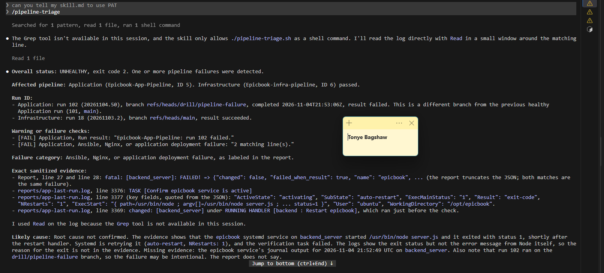
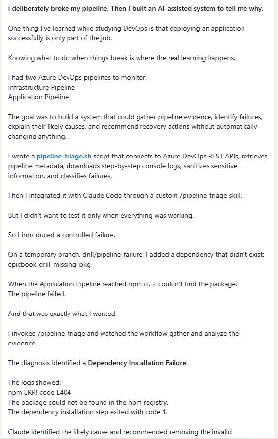

# Assignment 5 — AI-Assisted Azure DevOps Dual-Pipeline Failure Triage

Part of the DevOps Micro Internship (DMI) — Agentic AI Track

---

## Student Information

**Full Name:** [Enter your full name]

**GitHub Repository or Fork URL:** [Paste your repository URL]

**Public LinkedIn Post URL:** [Paste your LinkedIn post URL]

---

## Purpose

In this assignment, I configured an AI-assisted, read-only failure-triage workflow for the EpicBook Infrastructure and Application Pipelines. The workflow uses Bash to gather Azure DevOps pipeline evidence and Claude Code to analyze the evidence and recommend a recovery action while keeping all changes under human control.

---

# Task 0 — Verify Tools, Authentication, and Pipeline Details

## Goal

Verify the required tools, Azure DevOps authentication, organization and project details, and numeric pipeline IDs.

No screenshot is required for this task.

---

# Task 1 — Capture the Healthy Baseline and Prepare the Supplied Files

## Goal

Confirm that both EpicBook pipelines are healthy and place the supplied assignment files in the correct repository locations.

## Evidence

### Screenshot 1 — Healthy Baseline for Both Pipelines

Terminal output showing the latest completed Infrastructure and Application Pipeline runs with successful results.

## Notes

### 1. What proves that both pipelines were healthy before the drill?

Both Infrastructure and Application pipelines must have completed successfully in Azure DevOps, with their latest completed runs showing succeeded. The pipeline health report should also show HEALTHY, with exit code 0 and no warnings or failures.

### 2. Why is a healthy baseline necessary before introducing a controlled failure?

A healthy baseline establishes that both pipelines were functioning correctly before the incident. It provides a reference point for comparing the environment before and after the controlled failure.

Without it, I might incorrectly attribute an existing issue to the deliberate failure.

---

# Task 2 — Configure and Review the Supplied CLAUDE.md

## Goal

Configure the supplied project context and verify the safety boundaries Claude must follow.

## Evidence

### Screenshot 2 — CLAUDE.md Context and Safety Rules

`CLAUDE.md` open in the editor with the Project Overview, Incident Workflow, Safety Rules, and Output Rules visible.

## Notes

### 1. Why does Claude need project-specific operational context?

Claude needs project-specific context to understand the EpicBook architecture, the two Azure DevOps pipelines, their responsibilities, and the expected troubleshooting workflow.

This helps Claude interpret pipeline evidence accurately instead of making generic assumptions about the infrastructure or application.
[Write your answer here.]

### 2. Which rules keep the human responsible for the recovery action?

The assignment follows the workflow:
Gather

Analyze

Approve

Verify

Claude gathers and analyzes evidence. A human reviews and applies recovery actions before verification.
Claude must not automatically modify pipeline configurations, edit application code, push commits, approve deployments, or rerun pipelines. It can recommend a fix, but the engineer must review and apply it.

### 3. Which rules protect pipeline credentials and application secrets?

The workflow protects secrets by avoiding hardcoded credentials, keeping tokens out of reports, sanitizing downloaded logs, and preventing Claude from displaying sensitive environment variables.

PATs, passwords, SSH private keys, database credentials, and authorization headers must never appear in the final incident report or public repository.

---

# Task 3 — Configure and Validate the Supplied Pipeline Triage Script

## Goal

Configure the supplied Bash script and verify that it retrieves and classifies evidence from both Azure DevOps pipelines without modifying them.

## Evidence

### Screenshot 3 — Pipeline Triage Script Configuration

Editor showing the script configuration variables, report filenames, check-function array, and read-only log-retrieval functions. Ensure that no token is visible.

---

### Screenshot 4 — Script Validation

Terminal showing successful Bash syntax validation and executable file permission.

## Notes

### 1. Why are pipeline metadata and step console logs handled separately?

Pipeline metadata provides high-level information such as the pipeline name, run ID, status, result, branch, and completion time.

Console logs provide detailed evidence about what happened during individual pipeline steps.

Separating them allows the script to identify whether a pipeline failed before analyzing the specific technical cause.

### 2. How does the script obtain the actual console logs?

The Bash script uses Azure DevOps REST APIs to retrieve the latest completed build, request the list of associated log IDs, and download each step's console log.

The downloaded logs are combined, sanitized, and saved as:
- reports/infra-last-run.log
- reports/app-last-run.log

### 3. How does the check-function array control the classification loop?

The CHECK_FUNCTIONS array defines the checks the script performs and their execution order.

These checks cover dependency installation, compilation, testing, authentication, agent availability, Terraform, and Ansible/Nginx deployment errors.

The script loops through the array and executes each function against the sanitized logs of failed runs.

### 4. What prevents a failed but unmatched run from being reported as healthy?

The check_unclassified_failure() function handles this situation.

If Azure DevOps reports that a run failed but none of the known failure patterns match, the script records an Unclassified Pipeline Failure.

The run remains classified as failed rather than healthy.

### 5. Why are different exit codes useful to another automation tool?

Exit codes allow other tools to understand the result without manually interpreting the entire report.
Exit code	Meaning
0	Healthy
1	Warning or incomplete state
2	Pipeline failure
3	Configuration, authentication, API, or log-retrieval error

For example, Claude Code can distinguish an actual deployment failure from an authentication problem and recommend the appropriate next step.

---

# Task 4 — Run and Understand the Healthy-State Report

## Goal

Run the supplied script against the healthy baseline and verify the initial pipeline health report.

## Evidence

### Screenshot 5 — Healthy Pipeline Report

Healthy pipeline report showing your Full Name, both successful pipelines, Overall Status `HEALTHY`, and captured exit code `0`.

## Notes

### 1. What evidence proves that both pipelines are healthy?

The health report must show both pipelines' latest completed runs as succeeded, successful log retrieval, no warnings or failures, and an overall status of HEALTHY.

The script should return exit code 0.

### 2. Why must the baseline exit code be verified before the incident drill?

Verifying exit code 0 confirms that the triage workflow can recognize a healthy environment.

It also validates the script's authentication, API access, evidence collection, and health evaluation before introducing a deliberate failure.

---

# Task 5 — Configure and Test the Supplied /pipeline-triage Skill

## Goal

Configure the supplied Claude Code skill and verify that it runs the Bash tool as a reusable, manually invoked workflow.

## Evidence

### Screenshot 6 — Pipeline-Triage Skill Definition

`SKILL.md` showing the frontmatter, manual-invocation setting, narrowly scoped tools, safety rules, and required output structure.

---

### Screenshot 7 — Healthy Skill Result

Healthy `/pipeline-triage` result showing that both pipelines are healthy and no fix is required.

## Notes

### 1. Why is `disable-model-invocation: true` appropriate for this skill?

This setting prevents Claude from automatically invoking the skill based on its interpretation of the conversation.

Pipeline triage should be initiated deliberately by the engineer using /pipeline-triage, ensuring that the workflow runs only when requested.

### 2. Why should the skill avoid broad Bash approval?

Broad Bash approval could allow Claude to execute commands beyond the intended read-only diagnostic workflow.

Restricting permissions reduces the risk of accidental infrastructure changes, unauthorized deployments, credential exposure, or destructive operations.

### 3. What work is performed by Bash, and what work is performed by Claude?

Bash performs deterministic tasks such as authenticating, querying Azure DevOps APIs, retrieving logs, sanitizing sensitive information, classifying failure patterns, and generating reports.

Claude interprets the collected evidence, explains the likely root cause, recommends a recovery action, and provides a verification step.

### 4. Why are permission rules required in addition to written safety instructions?

Written instructions describe expected behavior, but permission rules provide an additional technical boundary.

Even if Claude misinterprets an instruction, restricted tool permissions can prevent it from executing commands outside the approved workflow.

---

# Task 6 — Introduce a Safe Failure in the Application Pipeline

## Goal

Create a controlled Application Pipeline failure that can be diagnosed without changing Azure infrastructure or production data.

## Evidence

### Screenshot 8 — Controlled Application Pipeline Failure

Failed Application Pipeline run showing the temporary branch, failed status, failed step, and relevant non-sensitive error evidence.

## Notes

### 1. What exact failure did you introduce?

On a temporary branch drill/pipeline-failure, I first added a pre-deploy "Dependency check (npm ci)" step to the Application Pipeline's Validate stage. Then, in a separate commit marked "DRILL", I added a dependency that doesn't exist, "epicbook-drill-missing-pkg": "^9.9.9", to package.json. When the pipeline ran npm ci, it couldn't install that package, and the step failed with npm ERR! errors.

### 2. Which category should detect it?

Dependency installation failure. The log contains npm ERR! lines, which the script's check_dependency_failure pattern matches.

### 3. Why is the failure safe and easily reversible?

The failing step runs only on the pipeline agent, in a temporary working folder, during the Validate stage. Because Validate failed, the Deploy and Verify stages were skipped. Ansible never connected to the VMs, the database and live site were untouched, and no Terraform, credentials, NSGs or Azure resources changed. Undoing it is a one-line revert of the DRILL commit.

### 4. How did you prevent the deliberate failure from reaching `main` or changing the deployed application?

All changes live only on drill/pipeline-failure. The pipeline's automatic trigger is limited to main, so I queued this run manually against the drill branch, and I didn't open a pull request. The failure happens in Validate, before the Deploy stage, so the application running on the frontend and backend VMs stayed exactly as deployed from main.

---

# Task 7 — Diagnose and Save the Incident Evidence

## Goal

Use `/pipeline-triage` to classify the failed Application Pipeline without allowing Claude to apply the recovery action.

## Evidence

### Screenshot 9 — Failed-State Diagnosis and Incident Report

`/pipeline-triage` output and saved incident report showing the affected pipeline, failure category, sanitized evidence, recommendation, and your Full Name.

## Notes

### 1. Which failure category was identified?

Dependency installation failure in the EpicBook-App-Pipeline (run 13, branch drill/pipeline-failure, failed step "Dependency check (npm ci)"). The Infrastructure Pipeline stayed healthy.

### 2. What exact evidence supported the diagnosis?

The failed step's console log, downloaded through the Build Logs API: npm ERR! code E404, npm ERR! 404 Not Found - GET https://registry.npmjs.org/epicbook-drill-missing-pkg and npm ERR! 404 'epicbook-drill-missing-pkg@^9.9.9' is not in this registry, followed by Bash exited with code '1'. Claude also pointed out it was a 404, not a 401 or 403, which ruled out an authentication problem.

### 3. Did Claude apply the fix or rerun the pipeline? Why is that important?

No. Claude ended with "I made no changes to any file, pipeline, or Azure resource." It recommended the fix and left applying it to me. That matters because a pipeline has access to credentials, infrastructure and production. Keeping the change with a human means someone who understands the context checks the recommendation first, and every change is deliberate and traceable to a person.

### 4. Which part represents Gather, and which part represents Analyze?

Gather is ./pipeline-triage.sh: it reads both pipelines' metadata and console logs through the read-only Azure DevOps API, classifies the failure and writes the report with exit code 2. Analyze is Claude inside /pipeline-triage: it reads the report and log evidence, explains the likely cause, rules out other categories, and recommends one fix and one verification step.

---

# Task 8 — Apply the Human-Reviewed Fix and Verify Recovery

## Goal

Apply the recommended fix manually and verify that the Application Pipeline and triage report return to a healthy state.

## Evidence

### Screenshot 10 — Corrected Application Pipeline Run

Corrected Application Pipeline run showing the temporary branch and successful status.

---

### Screenshot 11 — Recovery Triage Result

Recovery `/pipeline-triage` output showing Overall Status `HEALTHY`, exit code `0`, your Full Name, and both saved report filenames.

## Notes

### 1. What exact fix did you apply?

On drill/pipeline-failure I ran git revert on the DRILL commit, which removed "epicbook-drill-missing-pkg": "^9.9.9" from package.json. I checked that the package name no longer appears in the file, committed it as 2c8b4fd, pushed the branch, and queued the Application Pipeline against it manually. The pre-deploy dependency-check step stayed in place.

### 2. Did the fix match Claude’s recommendation? Explain briefly.

Yes. Claude recommended removing the epicbook-drill-missing-pkg entry from package.json and pushing, which is exactly what the revert did. It also suggested regenerating package-lock.json, but that wasn't needed: the drill never changed the lock file, so reverting package.json alone brought the two back in sync. I reviewed the recommendation against the log evidence before acting, and I applied the change myself.

### 3. What evidence proves that the pipeline recovered?

Run #20260928.2 (ID 14) of EpicBook-App-Pipeline on drill/pipeline-failure at commit 2c8b4fd succeeded in all three stages: Ansible Validate (including the dependency check), Configure VMs & Deploy EpicBook, and Verify EpicBook. The second /pipeline-triage run reported Overall Status HEALTHY with exit code 0 and all 16 checks passing, and I saved it as reports/recovery-report.txt.

### 4. Why is a second triage run required after the pipeline becomes green?

A green run only proves that pipeline passed. The second triage run checks both pipelines with the same rules as the incident, confirms that the specific dependency failure is gone and that no new warning or error appeared, and produces an exit code (0) that automation can trust. It also gives me a saved recovery report to compare with the incident report, which closes the Gather → Analyze → Human Act → Verify loop.

### 5. What risk would be created if Claude could automatically edit, push, approve, and rerun the pipeline?

Diagnosis and change would merge into one unchecked step. A wrong or partial diagnosis could be pushed straight into a pipeline that has access to cloud credentials, infrastructure and production. It might loop through retries, approve a deployment it shouldn't, or hide the real problem, and no human would have reviewed the change. Keeping Claude read-only means every change is deliberate, reviewed and traceable to a person.

---

# LinkedIn Post — Mandatory

## LinkedIn Post URL

https://lnkd.in/p/dqkNpbTW

## Evidence

### Screenshot 12 — Published LinkedIn Post

Published LinkedIn post showing its text and at least one image or link.

---

# Required Repository Files

Confirm that the following files are available in your repository:

* [ ] `CLAUDE.md`
* [ ] `pipeline-triage.sh`
* [ ] `.claude/skills/pipeline-triage/SKILL.md`
* [ ] `reports/incident-failure-report.txt`
* [ ] `reports/recovery-report.txt`

---

# Submission Instructions

* Complete all tasks in sequence.
* Include all 12 required screenshots.
* Answer every Notes question in your own words.
* Include your GitHub repository or fork URL.
* Include your public LinkedIn post URL.
* Ensure your Full Name appears in the required reports.
* Do not include raw logs containing sensitive information.
* Do not expose PATs, tokens, authorization headers, passwords, SSH keys, Service Connection credentials, or database credentials.

---

# Completion Checklist

* [ ] Both Azure DevOps pipelines were healthy before the drill.
* [ ] The supplied files were copied to the correct repository locations.
* [ ] Only the required student-specific placeholders were updated.
* [ ] `CLAUDE.md` contains the required context and safety rules.
* [ ] `pipeline-triage.sh` passed Bash syntax validation.
* [ ] The script has executable permission.
* [ ] The script uses read-only Azure DevOps operations.
* [ ] The script retrieves pipeline metadata and console logs.
* [ ] No token or password is stored in the script.
* [ ] The healthy baseline reported `HEALTHY` with exit code `0`.
* [ ] `/pipeline-triage` was invoked manually.
* [ ] The skill does not have broad Bash approval.
* [ ] The controlled failure affected only the Application Pipeline.
* [ ] The failure occurred before deployment changes were applied.
* [ ] The deliberate failure was not merged into `main`.
* [ ] The failed-state report was saved before applying the fix.
* [ ] Claude diagnosed the failure but did not apply the fix.
* [ ] The fix was reviewed and applied manually.
* [ ] The corrected Application Pipeline completed successfully.
* [ ] The recovery triage reported `HEALTHY` with exit code `0`.
* [ ] `incident-failure-report.txt` exists.
* [ ] `recovery-report.txt` exists.
* [ ] All Notes questions have been answered.
* [ ] All 12 screenshots have been added.
* [ ] The GitHub repository or fork URL has been included.
* [ ] The LinkedIn post is public.
* [ ] The LinkedIn post URL has been included.
* [ ] No sensitive information is exposed.

---

# Final Submission

**Full Name:** [Enter your full name]

**GitHub Repository or Fork URL:** [Paste your repository URL]

**LinkedIn Post URL:** [Paste your public LinkedIn post URL]

---

*This submission is part of the DevOps Micro Internship (DMI) — Agentic AI Track.*
